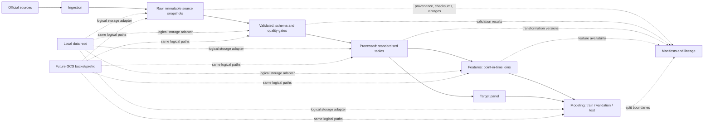

# 004. Rental Forecasting Data Architecture & Data Dictionary

**Status:** Design proposal for review; no pipeline, data, configuration, or cloud
resources are being implemented by this document.

## 1. Existing project decisions

The project already provides a useful foundation:

- `data/raw/`, `data/external/`, and `data/processed/` exist and are excluded
  from Git except for their `.gitkeep` markers.
- `configs/storage.toml` selects local storage and reserves a GCS bucket/prefix.
  It explicitly recommends keeping credentials out of configuration.
- `README.md` recommends an I/O abstraction, Parquet for derived data, and
  keeping production logic in `src/`.
- `src/ingestion/`, `src/processing/`, `src/features/`, `src/models/`,
  `src/evaluation/`, and `src/pipelines/` are package scaffolds. There are no
  existing data loaders, schemas, feature pipelines, or source-specific
  implementations to preserve or reuse.
- Python 3.12, pandas, pyarrow, NumPy, scikit-learn, and pytest are already
  declared. This proposal does not require new packages.

The proposal below extends the existing layout conceptually; it does not edit
existing project files or add implementation code.

## 2. Proposed architecture

### Directory layout

```text
data/
  raw/                         # Immutable source downloads/API responses
    ons_pipr/
      release=YYYY-MM-DD/
    bank_of_england/
      release=YYYY-MM-DD/
    ...
  external/                    # Externally maintained/reference inputs
  validated/                   # Source-shaped data after structural/quality gates
  processed/                   # Cleaned, typed, geography/date-standardised tables
  features/                    # Point-in-time-safe explanatory variables
  modeling/
    train/
    validation/
    test/
  manifests/                   # Small metadata, checksums, source/vintage records

docs/
  data-architecture-and-dictionary.md

src/
  ingestion/                   # Source-specific acquisition and raw registration
  processing/                  # Schema, quality checks, standardisation
  features/                    # Feature joins and point-in-time selection
  pipelines/                   # Repeatable stage orchestration
  models/
  evaluation/

configs/
  storage.toml                 # Existing local/GCS logical storage settings
```

Keep source-specific raw downloads unchanged. Store derived outputs in Parquet
for typed columns, compression, and efficient reads; retain CSV/XLSX/ODS/JSON
only when that is the original source format or is needed to reproduce the
source extraction. Do not add generated artifacts or private/licensed source
files to Git.

### Responsibilities and flow

| Layer | Responsibility | Example contents | Gate before promotion |
|---|---|---|---|
| Raw | Preserve what the publisher supplied, without edits. | Original ONS workbook/CSV, Bank of England export, retrieval metadata. | Download integrity and source/license recorded. |
| Validated | Confirm source structure and minimum quality while retaining source semantics. | Parsed source table plus validation results. | Required fields, types, uniqueness/grain, acceptable code/date values. |
| Processed | Standardise names, types, units, geography codes, and time representation; document transformations. | Monthly PIPR long table; harmonised LA reference table; annual supply table. | Transformation invariants and expected coverage pass. |
| Features | Create explanatory features with explicit observation and availability dates. | Lagged national rates, local annual supply, rolling or seasonal features. | Every joined value is available at the forecast cutoff. |
| Modeling | Assemble target and features into reproducible time-based splits. | Train/validation/test tables and split manifest. | No target leakage, split boundaries recorded, required target coverage met. |



### Names, versions, and reproducibility

- Use lowercase `snake_case` for columns and stable source identifiers. Keep
  `source_*` names in a source landing table if publisher headings are useful
  for auditability.
- Use one row per natural observation grain. A monthly rent row is keyed by
  `(geography_code, bedroom_category, observation_month, source_series_id)`;
  features also carry a source and vintage where relevant.
- Use ISO dates (`YYYY-MM-DD`) and an explicit monthly period such as
  `YYYY-MM`, rather than ambiguous month-end strings.
- Name files with dataset, grain, and vintage, e.g.
  `pipr_rent_la_bedroom_monthly__vintage=2026-10-22.parquet`. Treat the date as
  the source release/retrieval vintage, not as a substitute for observation
  date. Exact filenames should be settled after source formats are inspected.
- Record in a sidecar manifest: source URL/title, source release date (if
  supplied), retrieval timestamp, observation start/end, geography vintage,
  original filename/format, SHA-256 of raw bytes, schema version, validation
  outcome, transformation/code version, and any known licence/terms. For
  forecasts, also record `forecast_issue_date`, timezone-aware
  `forecast_cutoff_at`, selected `origin_month`, and `target_month`.
- Preserve raw vintages rather than replacing them. Version processed outputs
  by the input vintages and code revision; pin each historical forecast's
  issue/cutoff, origin/target months, training cutoff, and source vintages in
  modeling manifests. Git tracks code and small manifests, not dataset
  binaries. A data-versioning product is not necessary for the first local
  iteration; checksums and immutable release folders are a sufficient starting
  point.
- Keep paths logical and route I/O through the small storage boundary already
  anticipated by `configs/storage.toml`. Local paths can later map to
  `gs://<bucket>/<prefix>/...`; use runtime identity/secret management rather
  than placing credentials in TOML. No GCP setup is proposed now.

## 3. Data dictionary and source assessment

### Evidence labels

- **Verified landing page/details** means the linked official page was
  reachable and confirmed the cited fact during this design review.
- **Candidate / verify before ingestion** means the organization or source
  family is plausible, but the exact table, variable, geography, historical
  availability, access method, or terms must be confirmed against the release
  actually selected. A URL to a general official page is not evidence that a
  specific cut exists.
- Historical coverage below is deliberately not extrapolated from the project
  brief. “Confirm from release” is a required onboarding task, not an assumed
  date range.

| Source and official reference | Proposed variables and units | Frequency and geography | Coverage, release lag, revisions | Risks, ingestion, and forecasting relevance |
|---|---|---|---|---|
| **ONS Price Index of Private Rents (PIPR)**. [Monthly price statistics dataset](https://www.ons.gov.uk/economy/inflationandpriceindices/datasets/priceindexofprivaterentsukmonthlypricestatistics) and [private rent and house prices bulletin](https://www.ons.gov.uk/economy/inflationandpriceindices/bulletins/privaterentandhousepricesuk/latest). **Verified from the 21 October 2026 workbook:** monthly average rent levels are published for 294 approved English LAs by bedroom category, January 2015–September 2026; City of London and Isles of Scilly are not published in the audited target table. ONS identifies latest rent estimates as provisional and the newest two UK months as subject to a two-month revision policy. | Primary target: average monthly private rent level, GBP/month, by LA and bedroom count. Keep rent index/inflation series distinct from rent levels. | Monthly; the audited workbook contains complete 1-, 2-, and 3-bedroom series for the approved 294-LA cohort. The separate 296-LA April 2025 reference and two explicit exclusions are recorded in the Task 005.1 audit. | The audited edition covers Jan 2015–Sep 2026 with 124,362 of 124,362 target cells valid. Release edition date is retained, but it is not treated as an independently verified publication timestamp. Overlapping values differ between the March 2024 archive and latest edition; causes remain unresolved. | The initial versioned ingestion is documented in [Task 006](./006-ons-pipr-ingestion.md). It preserves raw releases and checksums, validates the named workbook table and target panel, and writes validated and processed Parquet. No target imputation. Use archived vintages or label historical tests approximate when exact PIT availability cannot be reconstructed. |
| **Bank of England (BoE) Bank Rate**. [Official Bank Rate history](https://www.bankofengland.co.uk/boeapps/database/Bank-Rate.asp). **Verified:** official rate and effective change dates are published. | Bank Rate, percent per annum; derive monthly mean, month-end rate, or change count from dated effective rates, naming each transformation. | Irregular effective-date changes; national UK series, not LA-level. | The official page provides historical changes; exact earliest coverage and update schedule should be captured from the downloaded series. Rate changes are published when decisions take effect; use the effective/published timestamp. | Direct page export or official series download; no geographic join needed. Candidate macroeconomic/financing signal. Never treat a later decision as known earlier in the month. |
| **Bank of England IADB series IUMZID4: sterling 2-year (75% LTV) buy-to-let fixed mortgage rate**. [Official Interactive Statistical Database series page](https://www.bankofengland.co.uk/boeapps/database/index.asp?EC=IUMZID4&From=Template&G0Xtop.x=1&G0Xtop.y=1&Travel=NIxSUx). **Verified directly:** page gives the official description: “Monthly interest rate of UK monetary financial institutions (excl. Central Bank) sterling 2 year (75% LTV) buy to let fixed rate mortgage to households (in percent) not seasonally adjusted.” It identifies IUMZID4 and showed “Published: 07 Oct 2026” when checked. | Monthly interest rate, percent, not seasonally adjusted. The description specifies a sterling-denominated two-year fixed BTL product at 75% LTV offered by UK monetary financial institutions excluding the central bank to households. | Monthly; UK-wide aggregate, not LA-level. | The series page showed a publication date of 7 October 2026 and a default display window of 2021–October 2026. That display window is not evidence of the series start. Earliest observation and historical gaps were not verifiable from the metadata page; confirm from a full-range export before ingestion. Routine publication cadence and the series-specific revision policy are not stated on the page and remain to be checked. | Use the series page’s date-range and CSV export controls (or its official database export) when ingestion is approved; preserve the original CSV and record retrieval/publication metadata and checksum, then parse observation month and rate into typed columns. This national financing-cost indicator is relevant to rental investment conditions. For point-in-time joins, retain each observation’s publication/availability date and source vintage; use only values published by the forecast cutoff. Do not assume the latest observation is available merely because its observation month has begun or ended. Until vintage history is available, use archived snapshots or a documented conservative release lag and flag backtests as vintage-limited. |
| **ONS Consumer Prices Index (CPI)**. [Consumer price inflation dataset](https://www.ons.gov.uk/economy/inflationandpriceindices/datasets/consumerpriceinflation). **Verified:** dataset page describes monthly UK CPIH, CPI, and RPI tables. | CPI/CPIH index (index points, base per series metadata) and/or 12-month percentage change. Keep CPI and CPIH as separate measures. | Monthly, UK national; no LA-level CPI series is established by this source. | Dataset landing page does not establish a single fixed start date or complete revision history here. Published monthly with CPI release; use each release's published date and retain vintages. | Ingest the selected official time series and its metadata. National inflation can represent broad cost/inflation conditions and support nominal-vs-real interpretation; not a local rent deflator unless that choice is explicit. |
| **Unemployment: ONS Annual Population Survey (APS), distributed via Nomis**. [Nomis APS dataset](https://www.nomisweb.co.uk/datasets/apsnew). **Verified:** residence-based survey; LA and above; quarterly updates; employment/unemployment variables; revision examples are documented. | Unemployment count and unemployment rate, percent, with denominator definition/age band retained. Select the ONS/Nomis labour-market definition rather than a generic “rate”. | APS is a rolling 12-month survey estimate, released quarterly; LA and larger geographies are available. | Exact series history varies by table/geography and should be read from the data extract. Quarterly updates and reweighting/corrections are possible; Nomis publishes revision notes. | Download via Nomis query/export or API after variable/area definitions are fixed. Small-area sampling uncertainty and suppressed/unstable LA estimates are material. Candidate measure of local labour-market conditions. |
| **Household income: ONS Regional Gross Disposable Household Income (GDHI)**. [Regional GDHI dataset](https://www.ons.gov.uk/economy/regionalaccounts/grossdisposablehouseholdincome/datasets/regionalgrossdisposablehouseholdincomegdhi). **Verified:** current dataset description says ITL1/ITL2/ITL3; editions shown cover 1997–2024. | GDHI at current prices; published measures may include aggregate GBP million, per-head GBP, and index. Preserve selected measure and units. | Annual, ITL geographies; this verified dataset is **not Local Authority-level**. | Current edition shown as 1997–2024. ONS regional accounts releases are annual and can revise historical estimates; exact publication date/vintage should be captured per release. | Ingest only if using an explicitly regional feature. For LA-level income, assess ONS ASHE earnings by workplace/residence as a clearly labelled individual-earnings proxy—not household income. Do not disaggregate GDHI to LA without a defensible method. |
| **HM Land Registry UK House Price Index (UK HPI)**. [UK HPI reports and monthly data](https://www.gov.uk/government/collections/uk-house-price-index-reports). **Verified:** official monthly archive; collection shows monthly updates, local authority data, and recent revision/structural-change notices. | Average house price (GBP), index, and/or annual/monthly change, with property type and seasonality definitions preserved. | Monthly; England/Wales LAs are relevant to the target domain; UK coverage differs by nation and should be checked for the selected table. | Historic archive exists; exact first usable month and LA-series completeness must be established from the chosen download. Monthly releases lag transactions and revise as late registrations arrive; latest 12 months may be provisional (as cited in the ONS bulletin). | Ingest HMLR source files, preserve each release vintage, and use property-type/LA codes. Housing market conditions are a plausible local demand/price signal, but HPI is not a rent measure. |
| **Population density: ONS population estimates plus land area**. [ONS population estimates topic](https://www.ons.gov.uk/peoplepopulationandcommunity/populationandmigration/populationestimates). **Candidate / verify exact LA table and land-area file.** | Derived density = mid-year resident population / land area, persons per km². Store numerator, denominator, area units, boundary vintage, and derived value. | Population estimates are annual; LA geography is available in ONS local-authority products, but use a compatible official area measure and boundary vintage. | Do not assume complete historical coverage or a constant geography. Population estimates are published after the reference mid-year and may be revised/rebased following census/re-estimation. | Ingest the official population series and matching official area lookup; derive density deterministically. A slow-moving context feature. Do not use population density as if it were a directly monthly-observed measure. |
| **Housing supply / completions: DLUHC (now MHCLG) live tables on net supply of housing**. [Live tables on net supply of housing](https://www.gov.uk/government/statistical-data-sets/live-tables-on-net-supply-of-housing). **Verified:** page links Table 122 (net additional dwellings by LA district) and Table 123 (component flows by LA district). | Prefer the new-build completion component where available (dwellings/year). Table 122 is net additional dwellings, not gross completions; never relabel it as completions. | Annual financial-year statistics; English LA districts. | Historic series and release schedule must be confirmed from the selected table/version. Annual release is lagged relative to the year measured; table editions may be updated/corrected. | Download the official live-table spreadsheet (ODS at time checked), retain it raw, parse with an existing dependency only after inspecting the file, and record edition date. Local supply is a plausible slower-moving rental-market feature. |
| **Planning approvals/applications: MHCLG planning applications statistics**. [Planning applications statistics collection](https://www.gov.uk/government/collections/planning-applications-statistics). **Verified:** collection documents quarterly reports; the page lists quarterly release dates and covers applications in England. | Use a precisely named count/rate such as applications granted or decisions granted, by application class/decision type. Distinguish received, decided, and granted counts. | Quarterly; LA/planning-authority tables for England, subject to table availability. | The collection archive reaches back to reports first published in 2013, but current comparable series start and gaps must be confirmed in tables. Releases follow the reference quarter; corrections/updates may occur. | Ingest release workbooks/tables and distinguish authority boundaries from LA boundaries. A leading supply proxy, but approval is not completion and applications can be withdrawn or delayed. |
| **Domestic/internal migration: ONS internal migration estimates**. [ONS internal migration topic](https://www.ons.gov.uk/peoplepopulationandcommunity/migrationwithintheuk). **Candidate / exact current local-authority table to verify.** | Internal inflows, outflows, and net internal migration, persons per reference year; define age/sex inclusions if used. | Annual estimates; LA-level tables exist for England and Wales in ONS population-estimate products, but source table and coverage must be checked. | Exact history, publication calendar, revision policy, and completeness are table-specific; do not infer them from a topic page. Typically released with annual population estimates after the reference period; retain the release vintage. | Use the ONS component estimates rather than reconstructing flows from unrelated population totals. Immigration can represent local demand, but estimates have lag, uncertainty, and boundary dependencies. |
| **International migration: ONS international migration estimates / mid-year population-estimate components**. [ONS international migration topic](https://www.ons.gov.uk/peoplepopulationandcommunity/populationandmigration/internationalmigration). **Candidate / exact local-authority table to verify.** | International inflow, outflow, and net migration, persons per reference year, retaining the ONS definition and estimation method. | Annual; LA availability and comparable series depend on the specific ONS table and methodology. | No single coverage interval or stable method is asserted here. Estimates and methods can be revised; record release vintage and method changes. | Acquire only from a named, documented ONS table. Do not combine domestic/international components across incompatible periods or methods without flags. Candidate local demand/context feature. |
| **Student population: Census 2021 (ONS/Nomis) resident student status**. [Nomis Census 2021 source](https://www.nomisweb.co.uk/sources/census_2021). **Candidate / exact table and category to verify.** | Count and share of usual residents classified as full-time students (or the selected census student-status category); persons / percent. | Census snapshot; local authority and smaller geographies may be available. It is not a monthly or annual panel. | Census 2021 is one snapshot; comparable future update would be the next census, not an assumed annual series. Census correction/quality metadata apply. | Obtain the exact table, denominator, residence definition, and boundary codes. Useful structural proxy for student rental demand; treat as static, clearly dated information, not current annual student enrolment. HESA provider enrolments are a separate, provider-location measure and must not be interpreted as LA resident population. |

### Source-selection findings

1. The Task 005.1 workbook audit verified the 294-LA × bedroom × month PIPR
   target panel for Jan 2015–Sep 2026. The Task 006 ingestion implements its
   initial download, validation, immutable release snapshot, and Parquet
   outputs. The two approved geographic exclusions and unresolved historical
   vintage/boundary limitations remain explicit.
2. The source catalogue should not treat all features as monthly. Annual,
   quarterly, irregular, and decennial observations retain their true
   observation frequency and publication date.
3. GDHI at the verified ITL level cannot be represented as an LA income series.
   Decide between a regional feature, a verified LA earnings proxy, or leaving
   income out.
4. The Bank of England IADB series IUMZID4 is the verified primary source for
   the exact 2-year, 75%-LTV BTL mortgage rate. Confirm its earliest
   observation, historical gaps, routine publication timing, and revision
   behavior from a full-range export before setting ingestion completeness and
   point-in-time lag rules.
5. “Housing completions” must be sourced from a completion component. Net
   additional dwellings include more than new builds.
6. The evidence is not a promise that the linked page will remain at the same
   URL or maintain the same series. Onboarding must save the source edition,
   metadata, licence, and extraction schema.

## 4. Target variable specification

### Definition

**Confirmed decision (Option A):** the 12-calendar-month horizon is anchored
to the latest eligible published rent observation month, not the forecast
issue month.

For each forecast, define:

```text
forecast_issue_date       = calendar date the forecast is generated
forecast_cutoff_at        = precise timezone-aware timestamp of its information cutoff
origin_month              = latest eligible published monthly rent observation month
target_month              = origin_month + 12 calendar months
forecast_horizon_months   = 12
```

The confirmed policy measures the horizon from the latest eligible published
rent observation month, not from the calendar month in which the forecast is
issued. For example, an illustrative forecast issued on 2026-10-22 could use
origin month 2026-09 and target month 2027-09, if the September rent observation
is confirmed published and eligible by that forecast's cutoff. The example is
not evidence of a specific ONS publication date or cutoff time.

For Local Authority `LA`, bedroom category `b ∈ {1, 2, 3}`, and origin month `t`:

```text
y(LA, b, t) = Rent(LA, b, t + 12 calendar months)
```

The outcome is the **future rent level in GBP per month**, not the 12-month
percentage growth rate. A growth-rate target can be derived later as a separate
experiment; it is not interchangeable with this target.

Recommended target-table grain:

```text
(forecast_issue_date, forecast_cutoff_at, geography_code, geography_vintage,
 bedroom_category, origin_month, target_month, target_rent_gbp,
 target_source_series_id, target_vintage)
```

- `forecast_cutoff_at` must include an explicit timezone/offset. The actual
  forecast issue date and cutoff timestamp are recorded per run; the operational
  timezone and scheduled cutoff convention remain to be chosen.
- Select the latest rent observation month that was genuinely published and
  available by `forecast_cutoff_at`; a month is not eligible merely because it
  has ended. `target_month` is exactly 12 calendar months after this
  `origin_month`.
- Store LA identifiers as official GSS geography codes, not names. Keep the
  source's own geography code and a dated crosswalk to canonical codes.
- Represent bedroom categories with controlled values `1`, `2`, and `3`.
  Do not include “all properties”, studios, or other categories in these
  series.
- Represent months as calendar-month periods. `target_month` is exactly 12
  calendar months after `origin_month`; it is not a 365-day duration.
- The forecast issue date, cutoff timestamp, and origin month are separate
  fields. `origin_month` identifies the latest eligible published rent month
  at the cutoff; it can precede the issue month. A particular observation must
  not be used to define the origin unless it was published by that cutoff.
- PIPR is a statistical estimate of average market rents, not a census of
  tenancy contracts. It may have sampling/administrative coverage limitations,
  small-sample effects, delayed publication, provisional values, and revisions.
  The released series definition and uncertainty notes should be retained.
- Missing or discontinued LA/bedroom observations stay missing and are
  explicitly flagged. Do not interpolate target labels or combine different
  source definitions to make a continuous-looking target.
- Latest eligible rent months can differ by LA or bedroom if source coverage,
  publication, or series continuity differs. For cross-area comparisons,
  recommend one common `origin_month` per forecast run: the latest rent month
  published by `forecast_cutoff_at` that meets a predeclared completeness rule
  across the fixed comparison cohort of LA-by-bedroom series. Do not let each
  row silently pick a different origin, since that would compare different
  target months.
  Confirm the cohort and completeness threshold after auditing official PIPR
  tables. If a series is missing or delayed at the common origin, keep its
  target unavailable, flag/exclude that row for that forecast, and report
  coverage; do not impute target values. A per-series latest-origin policy
  could be retained for separate operational forecasts, but must be labelled
  and not mixed into common-origin evaluation.

### Boundary and series continuity policy

Maintain a versioned geography dimension with code, name, nation, valid-from /
valid-to dates, and source boundary version. For a boundary change:

1. Prefer a publisher-provided consistent historical series or an official
   code/area correspondence.
2. Preserve the original geography series and document any mapped target
   geography.
3. Do not split or aggregate an average rent by averaging component LA averages
   without an appropriate rent/household/transaction weight.
4. If a defensible consistent target cannot be constructed, terminate the old
   series and start the new one, or exclude the affected geography/time span
   from that evaluation. Record the decision in the target manifest.

Historical backtests must reconstruct for every forecast row its historical
`forecast_issue_date`, timezone-aware `forecast_cutoff_at`, latest eligible
published rent `origin_month`, corresponding 12-month-ahead `target_month`,
and the feature values/vintages available at that cutoff. A label is eligible
for model training only if its target observation was published by the
historical model-training cutoff; do not use a label merely because its target
month has elapsed. For evaluation, score against a selected reference target
vintage, separate from the vintage available at the forecast cutoff.

## 5. Data validation strategy

Run checks at each layer and write structured outcomes to the run manifest.
Validation failures should identify dataset, partition, rule, and offending
sample rows without copying large or sensitive data into logs.

| Check | Hard failure (stop promotion) | Warning / review |
|---|---|---|
| Required schema and types | Required key/value fields absent; dates or values cannot be parsed; incompatible breaking schema change. | New optional source columns, reordered columns, or documented additive change. |
| Observation grain / duplicates | Duplicate natural keys after source-defined deduplication; conflicting values for the same source key. | Exact duplicate source rows that can be removed by a documented rule. |
| Missingness | Missing key, target value, source code, observation date, or availability/vintage field needed for PIT use. | Missing non-key feature values within declared thresholds; retain missingness flags and report by LA/time. |
| Geography | Invalid/unrecognised code, wrong nation, or many-to-one join not explained by an effective-dated crosswalk. | New/retired codes or name-only changes when the official crosswalk explains them. |
| Time | Invalid dates, impossible target offset, duplicate month, or unexpected gaps in a source declared complete/monthly. | Gaps caused by genuine source discontinuation, source publication lag, or explicitly irregular/annual/quarterly series. |
| Categories | Bedroom not in `{1, 2, 3}` in target; unexpected source category with no mapping. | New source category not used in current model, pending mapping review. |
| Values | Non-positive target rent; non-finite numeric values; impossible rate/percentage bounds under the documented definition. | Extreme but plausible values, abrupt month-to-month changes, or estimates with low reliability. |
| Outliers | Fail only when a value violates a known physical/domain constraint or parse/schema rule. | Statistical thresholds, robust z-scores, large change flags; never auto-delete a valid rent as an outlier. |
| Source freshness | Required scheduled source is absent or older than the configured maximum for the run's as-of date; partial download/checksum mismatch. | Source has not yet published the expected period but is within its documented release window. |
| Completeness | Required source partition or required series coverage falls below the predeclared minimum for target geography/months. | Coverage changes consistent with known boundary or series changes, after explicit approval. |
| Schema drift | Unknown key, unit, geography, or series definition; changed meaning/unit without approved mapping. | Additive metadata or non-key field changes that do not affect meaning. |
| Point-in-time availability | Any feature record has `available_at` after forecast cutoff, or a value's vintage cannot be established. | Conservative lag is being used because release timestamps are unavailable; record and review that limitation. |

Thresholds for feature missingness, series coverage, outlier flags, and source
freshness should be configured per source only after observing source release
cadence and quality. The target should have strict key/value checks and no
imputation. Warnings are not a substitute for a documented decision when
coverage or meaning changes.

## 6. Point-in-time data and leakage prevention

### Required time fields

Every observation used as a feature should preserve:

- `observation_period`: period the statistic describes;
- `published_at` or `available_at`: earliest date/time the value was public;
- `retrieved_at`: when this pipeline obtained it;
- `source_vintage`: release or edition identifier;
- optionally, `valid_from` / `valid_to` for geography or reference data.

Observation time and information-availability time are different. A December
labour estimate released in January is not available to a forecast issued in
December. A rent, house-price, or labour series later revised is not
automatically the value a historical model could have observed.

### As-of feature selection

For a forecast cutoff timestamp `c`, only select records with
`available_at <= c`. This applies to the rent observation used to establish
`origin_month` as well as every explanatory feature. Among records for the
same natural key, select the newest source vintage available by `c`, not the
latest vintage currently on disk. A feature's observation period may be
earlier than, equal to, or later than the rent origin month if its information
was genuinely available by `c`; never infer availability from observation
period alone. Store each feature's observation period, availability timestamp,
source vintage, and retrieval metadata so the as-of join can be audited.

If a publisher does not provide release timestamps or archived vintages:

1. Define and document a conservative availability lag based on the source's
   actual publication calendar.
2. Do not claim exact historical point-in-time reconstruction.
3. Prefer archived snapshots collected prospectively. Mark backtests as
   **exact point-in-time reconstruction** only when historical publication
   timestamps and source vintages support reconstruction of what was available
   at each cutoff. Otherwise label them **approximate retrospective
   backtests**, identify the lag/vintage assumptions, and disclose unavailable
   historical release snapshots.

### Frequency, lags, and carry-forward

- Monthly series may be joined only when the observation has been released by
  the cutoff, whether its observation period is before or after `origin_month`.
  A one-month observation lag is not inherently enough; use the actual
  publication date or a conservative source-specific lag.
- For quarterly and annual data, retain the quarter/year and publication date.
  Use the latest released value and carry it forward only until a declared
  maximum age; add `feature_age_months` and stale/missing flags.
- Forward-filling is a representation of “latest known value”, not new
  measurement. It must not fill backward, cross a source-definition break, or
  persist indefinitely. Do not forward-fill the target.
- For irregular policy rates, construct month-level summaries from only
  changes effective/known by the cutoff. State whether the feature is
  month-start, cutoff rate, or monthly average; a full-month average is
  unavailable before month-end.
- Never use a future-available observation, revised future vintage, centered
  rolling window, or a feature engineered using information not published by
  `forecast_cutoff_at`. The origin month is a target-horizon anchor, not the
  feature availability cutoff.

Modeling splits should be chronological, with each forecast row materialized
as-of its own historical cutoff and with the common origin/target-month policy
applied consistently. Fit scalers, imputers, feature selection, and any other
learned transformations on training data only. Recreate the same
feature-availability rules in backtests as in production.

## 7. Staged implementation plan

1. **Review source scope:** approve target definition, LA geography policy,
   candidate sources, and the income decision. For IUMZID4, verify full
   observation coverage, historical gaps, publication timing, and vintage or
   revision behavior from an approved full-range export, without yet training
   a model.
2. **Define contracts:** document natural keys, typed schemas, controlled
   bedroom/geography domains, units, date semantics, release/vintage fields,
   and per-source missingness/freshness expectations.
3. **Maintain target ingestion:** acquire later PIPR releases, preserve raw
   bytes and checksums, record metadata, and compare per-geography/bedroom/month
   coverage and revisions with prior vintages.
4. **Extend validation only as sources require:** the initial PIPR implementation
   produces typed validated and processed Parquet with manifests and a pinned
   geography reference; preserve its fail/warn distinction for future releases.
5. **Add one feature at a time:** prioritize relevant, obtainable series
   (e.g. Bank Rate, IUMZID4, APS unemployment, UK HPI, housing supply); verify
   availability dates and revisions before feature engineering.
6. **Build PIT features and splits:** materialize as-of feature snapshots for
   each historical cutoff; derive the latest eligible rent origin and target
   month exactly 12 calendar months later; apply a common-origin completeness
   rule for cross-area comparisons; enforce label availability at training
   cutoffs; and test leakage guards using controlled fixtures.
7. **Evaluate data before modeling:** report coverage, freshness, uncertainty,
   and cross-boundary effects. Only after data acceptance should forecasting
   models be trained.
8. **Consider cloud portability later:** keep the storage interface logical
   and validate local behavior first. GCS configuration/deployment is outside
   this proposal and can be designed when required.

## 8. Decisions and unresolved questions for review

### Recommended decisions

- Use PIPR as the primary rent-level target, conditional on confirming the
  requested LA/bedroom coverage and definition.
- Treat the project as monthly forecasting, while preserving feature sources'
  native frequencies and release dates.
- Preserve source vintages, use immutable raw snapshots, and produce
  Parquet-derived layers with checksummed manifests.
- Use GSS codes and an effective-dated geography dimension; do not make
  unweighted average-rent boundary conversions.
- Use Bank of England IADB series IUMZID4 as the primary 2-year, 75%-LTV BTL
  mortgage-rate feature, subject to confirming its historical coverage and
  point-in-time availability.
- Enforce point-in-time feature selection based on release availability.
- Do not substitute unsupported proxies without naming and documenting the
  change.

### Questions to resolve before implementation

1. Which operational timezone and forecast-generation/cutoff schedule should
   be used? Each run must record an exact timezone-aware timestamp regardless.
2. Does the selected PIPR release provide every requested LA × bedroom series
   continuously from Jan 2015 through Sep 2026, and what is its final revision
   policy/series definition?
3. What fixed LA-by-bedroom comparison cohort and completeness threshold
   should define the common origin month? Can the chosen PIPR release support
   that cohort without mixing unlike series?
4. Should the main geography be current LA boundaries, historical source
   boundaries, or a stable aggregate where a change prevents comparability?
5. For IUMZID4, what is the earliest available observation, are there gaps,
   what is its routine release timing, and are historical observations revised?
   Which archived vintage or conservative availability lag is available for
   backtests?
6. Is regional GDHI useful despite its ITL geography, or should an LA-level
   earnings proxy be investigated instead?
7. Which annual/quarterly features justify inclusion given publication lag and
   small-area estimate uncertainty?
8. What minimum target coverage and missing-series policy should govern
   inclusion of an LA/bedroom time series?
9. Which vintage should be the canonical evaluation truth: first released
   target value or a later settled/revised estimate?

No code, source datasets, dependencies, GCP resources, CI/CD, model, commit, or
GitHub changes are part of this design proposal.
