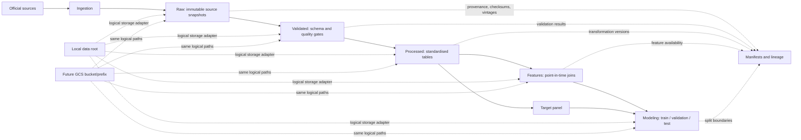

# 004. Rental Forecasting Data Architecture & Data Dictionary

**Status:** Living design and source assessment; current modelling-scope decisions
updated for Task 013.1 on 21 November 2026. Sections 2 and 4-6 retain the proposed architecture and confirmed
forecasting decisions; Section 3 records source evidence and its limits. The
Section 7 ingestion batches are proposals for project-owner review, not approval
to implement them. No production ingestion or feature functionality is added by
the research sections. Tasks 007, 008 and 009.2 implement Bank of England, inflation,
UK HPI and approved ASHE earnings ingestion; see their implemented contracts below. Other proposed
batches remain unapproved.

**Current modelling scope (Task 013.1, 21 November 2026):** Household Growth
and Student Population Share are **Excluded from Current Modelling Scope** by
explicit owner decision. Their proposed definitions and source findings remain
below as research history, not approved modelling inputs. Reconsideration needs
new evidence and owner approval. Other predictor statuses, the approved 294-LA
cohort and the 12-calendar-month forecast horizon are unchanged.

## 1. Existing project decisions

The project already provides a useful foundation:

- `data/raw/`, `data/external/`, and `data/processed/` exist and are excluded
  from Git except for their `.gitkeep` markers.
- `configs/storage.toml` selects local storage and reserves a GCS bucket/prefix.
  It explicitly recommends keeping credentials out of configuration.
- `README.md` recommends an I/O abstraction, Parquet for derived data, and
  keeping production logic in `src/`.
- `src/ingestion/ons_pipr.py` implements the initial PIPR acquisition,
  immutable release registration, validation, and Parquet publication described
  in [Task 006](006-ons-pipr-ingestion.md). Preserve this implementation and its
  tests. The remaining processing, feature, model, evaluation, and pipeline
  packages remain scaffolds.
- The approved target cohort is 294 English LAs, excluding City of London and
  Isles of Scilly, with separate 1-, 2-, and 3-bedroom rent levels. Preserve the
  confirmed Option A origin and 12-calendar-month horizon in Section 4.
- Python 3.12, pandas, pyarrow, NumPy, scikit-learn, and pytest are already
  declared. This proposal does not require new packages.

The architecture below remains a proposal beyond the implemented PIPR workflow.
Source findings inform later decisions; they do not authorise additional
implementation.

## 2. Proposed architecture

### Implemented Bank of England source contract (Task 007, 21 November 2026)

The owner authorised Bank Rate and IUMZID4 ingestion in
[Task 007](007-boe-bank-rate-and-iumzid4-ingestion.md). The
[implementation report](007-boe-bank-rate-and-iumzid4-ingestion.md#implementation-report---21-november-2026)
documents schemas, source definitions, validation, execution and recovery;
[live evidence](../reports/data_audits/007/validation-evidence.json) records
requests, checksums and measured counts. This implements those two sources only,
not the remaining proposed architecture below.

- `ingestion.boe` uses the official Bank Rate HTML effective-date history and
  documented IUMZID4 XML revision interface, with the existing storage TOML.
  Each existing raw/validated/processed layer contains
  `bank_of_england/{dataset}/snapshot={snapshot_id}/`; the identifier denotes
  retrieval, not a certified historical release edition. Immutable manifests
  preserve exact requests, response metadata, UTC retrievals and checksums.
- Bank Rate: 259 unadjusted change events, 20 January 1975-5 November 2026.
  `events.parquet` has date `effective_date`, float `rate_percent`, exact source
  date/value text and snapshot provenance. Monthly/forecast-cutoff semantics
  remain deferred; effective dates are not announcement timestamps.
- IUMZID4: 178 consecutive monthly observations, January 2012-October 2026;
  336 retained value/status events in the inspected snapshot. Validated current
  and history tables preserve source states; processed selected and history
  tables distinguish model-input policy from audit revisions. Rates remain
  percent, not seasonally adjusted. No monthly financing features are produced.
- Selected keys are `observation_month` (`YYYY-MM`); history keys add integer
  `event_order`. Values retain numeric and exact source-string representations,
  provisional/final status, naive source update strings, source attributes,
  observation date, snapshot/checksum/retrieval fields and source notes. Earliest
  recorded provisional observations are eligible; subsequent revisions cannot
  replace the selected observation. Every selection is explicitly labelled
  `earliest_recorded_not_certified`; missing revisions are labelled
  `current_update_only`. Pre-October-2016 observations are backfill flagged.
- Owner accepts the February 2019 transition with published history unchanged;
  the July 2018 population note is preserved. The illustrative -0.17pp comparison
  is not a universal adjustment. Original publication completeness, timezone and
  full release calendars remain unverified (ISS-004/ISS-005). Exact PIT joins
  and operational cutoff decisions remain future work (ISS-014).
- Both sources' database-data reuse was checked against the Bank's legal terms
  on 21 November 2026: OGL, attribution to the Governor and Company of the Bank
  of England; no selected-source exception found. Underlying third-party
  microdata rights are not inferred. No licensed microdata is acquired.

### Implemented inflation and UK HPI contract (Task 008, 21 November 2026)

The owner approved CPI and CPIH annual rates **and** index levels, plus UK HPI
all-property average prices and indices. This is source ingestion, not final
feature selection. [Task 008](008-ons-inflation-and-uk-hpi-ingestion.md#implementation-report---21-november-2026)
documents source definitions, schema, validation/recovery and source limits;
[live evidence](../reports/data_audits/008/validation-evidence.json) records
independent downloads, counts, revisions and provenance.

| Implemented source | Selected fields and units | Measured current coverage |
| --- | --- | --- |
| ONS D7G7 / L55O, MM23 | CPI / CPIH published all-items annual inflation, percent | 454 monthly values each, Jan 1989-Oct 2026 |
| ONS D7BT / L522, MM23 | CPI / CPIH all-items index levels, 2015=100 | 466 monthly values each, Jan 1988-Oct 2026 |
| HM Land Registry / ONS UK HPI, Sep 2026 release | All-property standardised average price GBP and index, Jan 2023=100 | 152,730 rows / 405 source areas; 112,014 cohort rows, 294 LAs x 381 months, Jan 1995-Sep 2026 |

`ingestion.ons_inflation` retains 1,840 current and 1,836 latest-advertised-prior
monthly observations, keyed by series/version/month, with exact source value,
release/update/reference strings, units/base, snapshot/checksum/retrieval fields
and metadata. Full version inventories/correction notices remain available; the
whole historical archive is not reconstructed. No rates are recomputed and no
first-release selection policy is inherited from IUMZID4.

`ingestion.uk_hpi` retains the complete source table and standardised observations
for all source areas, a separate exact-code cohort table and authority/month
coverage reports. All 294 cohort codes match; there are zero missing selected
cohort values or authority-month rows in the inspected releases. Eleven name
variants are flagged with both source and approved names preserved. No names
or historical codes are used for automatic remapping. Geography inventory and
raw files preserve source scope beyond the cohort. The pre-1995 regional/national
derived series does not extend LA coverage before January 1995.

Both September and August 2026 HPI releases are retained independently, with
their England publication-label revision matrices. Across 111,720 overlapping
cohort rows, 3,523 prices and 2,843 indices differ. No canonical input vintage
is selected. Current HPI's Jan 2023 base and the publisher's 2025 re-reference
are documented without adjusting data. Aggregate revision matrices do not
establish complete LA publication histories. Source publication-month labels
and ONS metadata timestamps are not certified exact public-availability times.

Existing raw/validated/processed layers use `ons_inflation/snapshot={id}/` and
`uk_hpi/snapshot={id}/`. Original responses are immutable per-source bundles;
derived Parquet/manifests retain source hashes, safe HTTP metadata, release
identification, validation and licences. ONS/HPI OGL reuse and attribution were
checked on 21 November 2026. All current inflation values and both HPI measures
reconcile with independent official CSV exports; 60 snapshot files retained
identical hashes on offline reruns. Detailed evidence is in the linked report.

ISS-003/004/012/013/014 remain Open for their broader or future checkpoints.
The approved source contract can proceed with these documented limits, without
implementing geographic mappings, forecast-cutoff rules or model features.

### Proposed directory layout

```text
data/
  raw/                         # Immutable source downloads/API responses
    ons_pipr/
      release=YYYY-MM-DD/
    bank_of_england/
      release=YYYY-MM-DD/
    ...
  external/                    # Externally maintained/reference inputs
  validated/                   # Source-shaped data after structural/quality gates
  processed/                   # Cleaned, typed, geography/date-standardised tables
  features/                    # Point-in-time-safe explanatory variables
  modeling/
    train/
    validation/
    test/
  manifests/                   # Small metadata, checksums, source/vintage records

docs/
  data-architecture-and-dictionary.md

src/
  ingestion/                   # Source-specific acquisition and raw registration
  processing/                  # Schema, quality checks, standardisation
  features/                    # Feature joins and point-in-time selection
  pipelines/                   # Repeatable stage orchestration
  models/
  evaluation/

configs/
  storage.toml                 # Existing local/GCS logical storage settings
```

Keep source-specific raw downloads unchanged. Store derived outputs in Parquet
for typed columns, compression, and efficient reads; retain CSV/XLSX/ODS/JSON
only when that is the original source format or is needed to reproduce the
source extraction. Do not add generated artifacts or private/licensed source
files to Git.

### Responsibilities and flow

| Layer | Responsibility | Example contents | Gate before promotion |
|---|---|---|---|
| Raw | Preserve what the publisher supplied, without edits. | Original ONS workbook/CSV, Bank of England export, retrieval metadata. | Download integrity and source/license recorded. |
| Validated | Confirm source structure and minimum quality while retaining source semantics. | Parsed source table plus validation results. | Required fields, types, uniqueness/grain, acceptable code/date values. |
| Processed | Standardise names, types, units, geography codes, and time representation; document transformations. | Monthly PIPR long table; harmonised LA reference table; annual supply table. | Transformation invariants and expected coverage pass. |
| Features | Create explanatory features with explicit observation and availability dates. | Lagged national rates, local annual supply, rolling or seasonal features. | Every joined value is available at the forecast cutoff. |
| Modeling | Assemble target and features into reproducible time-based splits. | Train/validation/test tables and split manifest. | No target leakage, split boundaries recorded, required target coverage met. |



### Names, versions, and reproducibility

- Use lowercase `snake_case` for columns and stable source identifiers. Keep
  `source_*` names in a source landing table if publisher headings are useful
  for auditability.
- Use one row per natural observation grain. A monthly rent row is keyed by
  `(geography_code, bedroom_category, observation_month, source_series_id)`;
  features also carry a source and vintage where relevant.
- Use ISO dates (`YYYY-MM-DD`) and an explicit monthly period such as
  `YYYY-MM`, rather than ambiguous month-end strings.
- Name files with dataset, grain, and vintage, e.g.
  `pipr_rent_la_bedroom_monthly__vintage=2026-10-22.parquet`. Treat the date as
  the source release/retrieval vintage, not as a substitute for observation
  date. Exact filenames should be settled after source formats are inspected.
- Record in a sidecar manifest: source URL/title, source release date (if
  supplied), retrieval timestamp, observation start/end, geography vintage,
  original filename/format, SHA-256 of raw bytes, schema version, validation
  outcome, transformation/code version, and any known licence/terms. For
  forecasts, also record `forecast_issue_date`, timezone-aware
  `forecast_cutoff_at`, selected `origin_month`, and `target_month`.
- Preserve raw vintages rather than replacing them. Version processed outputs
  by the input vintages and code revision; pin each historical forecast's
  issue/cutoff, origin/target months, training cutoff, and source vintages in
  modeling manifests. Git tracks code and small manifests, not dataset
  binaries. A data-versioning product is not necessary for the first local
  iteration; checksums and immutable release folders are a sufficient starting
  point.
- Keep paths logical and route I/O through the small storage boundary already
  anticipated by `configs/storage.toml`. Local paths can later map to
  `gs://<bucket>/<prefix>/...`; use runtime identity/secret management rather
  than placing credentials in TOML. No GCP setup is proposed now.

## 3. Data dictionary and source assessment

### Task 006.2 scope and evidence status

Inspection date: **8 November 2026**. The [original task prompt](006.2-predictor-data-availability-and-quality-exploration.md)
is archived verbatim. This assessment covers every candidate in that prompt and
three proposed supply ratios. It does not approve predictors, set quality
thresholds, assess predictive usefulness, or implement ingestion or features.

Repository review reused the [Task 005.1 audit](005.1-ons-pipr-workbook-coverage-audit.md),
[Task 006 guide](006-ons-pipr-ingestion.md), README, storage configuration,
pinned geography reference, and existing implementation/tests. The [Task 006.1
reliability-hardening prompt](006.1-harden-ons-pipr-ingestion-reliability-and-release-validation.md)
has now been restored from its original Word document. It establishes the task's
instructions, not an execution report; the source ends at "4. Improve Future
Release", so later instructions and acceptance criteria are unavailable.
Existing commit `dcde621` records completion of Tasks 006 and 006.1, while the
Task 006 guide describes the implemented reliability behavior. Earlier
audit recommendations awaiting cohort approval are historical; the 294-LA
cohort is now approved in Task 006 and the current task.

Evidence labels apply to claims, not final dataset acceptance:

- **Verified (V):** exact variable/definition confirmed in an official source or
  inspected extract. This does not imply all years and all authorities were tested.
- **Partially verified (P):** official source identified, with unresolved field,
  coverage, access, or historical-vintage questions.
- **Unverified (U):** requested measure at the requested geography not established
  by the investigated evidence. It remains a candidate.
- **Derived (D):** proposed calculation from indicated underlying data; no derived
  predictor was constructed here.

Measured findings are recorded with URLs, UTC retrieval timestamps, SHA-256
hashes, field definitions, and denominators in [the exploration evidence](../reports/data_audits/006.2/predictor-exploration-evidence.json).
Publisher descriptions of ranges are labelled separately. No unmeasured
predictor has an asserted 294-LA completeness percentage.

### Candidate predictor assessment matrix

Source keys link each variable to the source-characteristics table below,
which supplies publication timing, revisions, accessibility, uncertainty and
open questions. Coverage means observations, not historical availability.

| Variable | Underlying source / definition and units | Geographic level | Historical coverage established here | Status / construction dependency |
|---|---|---|---|---|
| Local Authority | P0; pinned GSS code and authority name | 294 English LAs | April 2025 reference; rent observations Jan 2015-Sep 2026 | V; structural identifier, no encoding performed |
| Bedroom Category | P0; integer 1, 2, or 3 | LA by bedroom | Jan 2015-Sep 2026 | V; structural category |
| Current Rent | P0; average monthly private rent, GBP/month | LA by bedroom | Jan 2015-Sep 2026 | V; establish eligibility at each cutoff |
| 3-month Rental Growth | P0; proposed `100 * (rent[t] / rent[t-3] - 1)`, percent | LA by bedroom | Endpoints structurally possible Apr 2015-Sep 2026 in audited vintage | D; definition proposed, same-vintage eligible observations required |
| 12-month Rental Growth | P0; proposed `100 * (rent[t] / rent[t-12] - 1)`, percent | LA by bedroom | Endpoints structurally possible Jan 2016-Sep 2026 | D; no growth feature generated |
| BoE Bank Rate | B1; official policy rate, percent | UK national | Inspected change-date page spans 20 Jan 1975-5 Nov 2026; earlier history not established | V; cutoff rate/monthly-summary choice open |
| 2-year 75% LTV BTL Mortgage Rate (IUMZID4) | B2; quoted sterling mortgage rate, percent, not seasonally adjusted | UK national | Measured Jan 2012-Oct 2026, 178 consecutive months | V; historical release vintages remain P |
| Median Earnings | E1; approved gross annual median employee-job earnings, Table 8.7a All D; GBP/year; all sexes and full-/part-time | LA residence | Verified in 37 advertised editions, 2002–2026; historical cohort varies | Task 009.2 ingestion implemented; all editions/source rows retained. Annual guide: adult-rate jobs held over a year; tax year ending 5 April. Two source-note conflicts flagged |
| Earnings Growth | E1; proposed percentage change in consistent annual median earnings | LA residence | First usable pair unresolved; no continuous 2002-2026 LA panel assumed | D/P; annual pay definition approved in Task 009.1; growth unimplemented, geography and vintages must agree |
| Unemployment Rate | U1; owner-approved UMB-first published model-based rate, ITEM 2 / MEASURES 20100; percent of economically active residents 16+ | LA residence; native source geography preserved | API: 87 rolling annual periods, Jan–Dec 2004 to Jul 2025–Jun 2026; separate M01 archive 1996/97–2003/04 verified | Production ingestion validated in Task 009.4; original geography and rolling-year semantics retained. Latest 292 exact cohort matches, 292 numeric rates/273 confidence margins; two code discrepancies |
| Population Density | D1 MYE5; population per square kilometre, supplied area denominator | LA | Inspected workbook mid-2011-mid-2025 | Task 010: source ingestion validated offline; 292/294 on 2023 geography, 288 on 2021 geography; no density calculation or mapping |
| Population Growth | D1 MYE4; proposed percentage change between comparable annual mid-year populations | LA | Population mid-2011-mid-2025; annual pairs possible from 2012 on matched codes | D; revised population vintage and boundary policy required |
| Household Growth | H1/H2; historical proposal: change in number of households, not dwellings | LA | APS estimates 2020-2022; admin-based estimates 2021-2023; projections base 2022 through 2047 | **Excluded from Current Modelling Scope** (Task 013.1); consistent, timely observed annual 2015–2026 coverage for the required LA population not established. Estimate/projection concepts remain distinct; future reconsideration requires evidence and owner approval |
| Net Internal Migration | D1 MYE3; internal inflow minus outflow, persons in year to mid-year | LA | Task 010: verified detailed editions cover years to mid-2012 through mid-2025 separately by vintage | Task 010 source-level history validated offline; no ratio/feature or model-input vintage selected |
| Net International Migration | D1 MYE3; international inflow minus outflow, persons in year to mid-year | LA | Task 010: same verified detailed 2012-2025 history and native vintage/geography preservation as internal migration | Task 010 source-level inputs validated; complete historical vintages/PIT remain unresolved |
| Student Population Share | S1; historical proposal: possible Census TS068 student count / compatible population denominator, percent | LA residence / term-time residence | 21 March 2021 snapshot verified; no annual panel established | **Excluded from Current Modelling Scope** (Task 013.1); annual LA panel for the modelling period not established. TS068 includes schoolchildren aged 5+, not a direct higher-education concentration measure; future reconsideration requires evidence and owner approval |
| Average House Price / HPI | M1; UK HPI average price in GBP or index (retain series base) | LA, also regional/national | Publisher documents England/Wales transactions from Jan 1995; current inspected release describes Aug 2026 | P for exact 294-LA history; dataset/measure V |
| 12-month House-price Growth | M1; published annual change or proposed same-vintage index ratio, percent | LA | Earliest usable LA year-on-year pair unmeasured; no complete history inferred from 1995 source start | D/P; do not mix property definitions or vintages |
| Housing Completions | M2 Table 123 `New build`, dwellings completed in financial year | English LA district | Inspected sheets 2012-13 through 2024-25 | V; annual net-supply component, distinct from quarterly housebuilding return |
| Net Additional Dwellings | M2 Table 122; net stock flow, dwellings per financial year | English LA district | Inspected 2001-02 through 2024-25 | V; can be negative, includes more than new build |
| Planning Approvals | M3 PS2; granted major/minor residential application decisions, counts | Local planning authority (LPA) | Measured 2025 Q3-2026 Q2; publisher describes PS2 history from Q2 1979 | V for application counts; historical definition continuity unverified |
| CPI Inflation | C1 D7G7; all-items 12-month percentage change | UK national | Official monthly table displays Jan 1989-Sep 2026 | V; longer modelled history is distinct |
| CPIH Inflation | C1 L55O; all-items 12-month percentage change including owner-occupier housing costs, percent | UK national | Official monthly table displays Jan 1989-Sep 2026 | V; keep distinct from CPI |
| Dwelling Stock (supply denominator) | M4 Table 125 unrounded; all dwellings including vacants, count at 31 March | English LA district | Inspected 2001-2025 | V; not households or private rented stock |

P0 reuses the existing audit: 294 LAs x 3 bedrooms x 141 months = **124,362**
valid rent observations in the 21 October 2026 edition. It does not repeat the
audit or claim historical rent values were publicly available in 2015. The two
rent-growth starting dates are calendar-endpoint deductions from that panel,
not historical point-in-time completeness measurements.

### Owner-approved current-scope exclusions - Task 013.1, 21 November 2026

The [owner instruction](013.1-predictor-exclusions-and-security-status.md)
excludes both predictors from the current modelling scope. This is a scope and
data-availability decision, not a correlation result or a permanent judgement
about predictive usefulness. It does not approve alternative measures, synthetic
annual observations, feature construction or additional research.

**Household Growth — Excluded from Current Modelling Scope.** The existing
[source assessment](#underlying-source-characteristics-and-evidence), recorded
for Task 006.2, identified H1 APS household estimates for 2020–2022 (released
12 March 2024), H1 administrative-data-based estimates for 2021–2023 (released
8 September 2026), and H2 household projections based on 2022 through 2047
(released 28 October 2025); older 2018-/2016-based projection editions were also
identified. These are identified products, not a verified 294-LA annual panel:
the household workbooks were not parsed and completeness/comparability was not
measured. The observation years and release dates do not establish consistent,
timely historical availability across the required 2015–2026 period.

APS estimates are survey-based; administrative-data-based estimates use a
different estimation method, have revised methods and lack uncertainty measures
in the recorded assessment. The latter were published as development estimates
for comparison, with an explicit warning against decision-making use. Nominal
annual reference years do not establish a comparable observed annual history.
Projection years instead describe future households under demographic/scenario
assumptions; they are not realised observations and cannot fill historical gaps
without an approved methodology. The recorded projection geography differs
between the principal April 2022 geography and a migration variant on April 2023
geography. Historical LA boundaries, the target cohort, scenarios, reference
periods and release vintages have not been reconciled. Household counts must
also remain distinct from dwelling-stock counts. No sufficiently consistent,
timely observed annual series for the required population and period has been
established, so Household Growth is not approved as a current modelling input.
This does not establish that no suitable dataset can exist. Future reconsideration
requires new coverage/methodology evidence and explicit owner approval; estimates
and projections must not be spliced silently.

**Student Population Share — Excluded from Current Modelling Scope.** S1 in the
[existing source assessment](#underlying-source-characteristics-and-evidence)
identifies Census TS068, its Nomis definition and bulk-file route. The recorded
Census day is 21 March 2021, with first release on 10 January 2023. A Census
snapshot does not establish an annual LA series over 2015–2026 and was not
information available in 2015. Repeating or backfilling a snapshot would not
create observed annual history. TS068 covers usual residents aged five and over
in full-time education, including schoolchildren, and must not be presented as a
direct measure of higher-education student concentration. Away-from-home
students use term-time addresses; numerator/denominator populations, residence
concepts and compatible geography require separate definition. The recorded
assessment also notes disclosure perturbation, a changed age definition for
comparison with 2011, and unmeasured reconciliation from Census to current LA
boundaries. These temporal, definitional and geographic gaps prevent approval
of this proposed measure for the current modelling scope. They do not show that
all alternative student datasets are unavailable. Provider enrolments are a
different concept, not an approved substitute; any future reconsideration needs
new evidence and owner approval.

Original official-source links and earlier observations remain in H1/H2/S1
below; the exploration evidence and previous task reports are unchanged.
ISS-007/ISS-008 are resolved only for the current exclusion decisions. Broader
geography, source-quality and point-in-time issues remain open where they affect
other predictors. No new data acquisition or empirical feature selection was
performed for this decision record.

### Underlying source characteristics and evidence

New external findings below were checked on 8 November 2026; explicitly labelled
earlier evidence is retained without re-audit. Release labels and dates are those
observed, not forecasts of future updates. Lags labelled estimates are calendar
arithmetic, not publisher guarantees.

H1/H2/S1 retain the historical source assessment, including research questions
that preceded Task 013.1. They are not active ingestion approvals or current
modelling inputs: the owner exclusions above now govern those two predictors.

| Key and official source | LA completeness / quality evidence | Publication timing and revisions | Accessibility / remaining questions |
|---|---|---|---|
| P0: [ONS PIPR, existing audit and ingestion](006-ons-pipr-ingestion.md) | Approved 294-LA panel; no target gaps in audited vintage. Historical boundary/vintage differences already documented. | Edition 21 Oct 2026; `published_at` remains unverified. Retrospective values differ between archives. | Local immutable XLSX and validated/processed Parquet implemented. No additional PIPR download. |
| B1: [BoE official Bank Rate history](https://www.bankofengland.co.uk/boeapps/database/Bank-Rate.asp) | National; LA completeness not applicable. Inspected dates cover project observation window. Full-export gap/duplicate analysis not performed. | Effective dates are not precise announcement timestamps. Retain decision publications for exact cutoffs. | HTML table/export controls; monthly transformation and earliest full history not tested here. |
| B2: [BoE IADB IUMZID4](https://www.bankofengland.co.uk/boeapps/database/index.asp?EC=IUMZID4&From=Template&G0Xtop.x=1&G0Xtop.y=1&Travel=NIxSUx) and [inspected CSV](https://www.bankofengland.co.uk/boeapps/database/_iadb-fromshowcolumns.asp?csv.x=yes&Datefrom=01/Jan/2012&Dateto=08/Nov/2026&SeriesCodes=IUMZID4&CSVF=TN&UsingCodes=Y&VPD=Y&VFD=N) | 178/178 expected months, all numeric, zero duplicate months, Jan 2012-Oct 2026. National, not LA-level. | Retrieval is not publication proof. Selection page still says 7 Oct 2026 despite CSV containing October observations; do not attach that page date to every observation. See methodology evidence below. | Parameterised CSV download demonstrated. Exact archived releases unresolved. |
| E1: [ONS ASHE Table 8](https://www.ons.gov.uk/employmentandlabourmarket/peopleinwork/earningsandworkinghours/datasets/placeofresidencebylocalauthorityashetable8) and [ASHE QMI](https://www.ons.gov.uk/employmentandlabourmarket/peopleinwork/earningsandworkinghours/methodologies/annualsurveyofhoursandearningslowpayandannualsurveyofhoursandearningspensionresultsqmi) | Approved annual gross median All field; employee jobs, not household/self-employed income. Annual guide: adult-rate jobs held over a year; annual pay includes absence-affected pay. Two historical table footnotes conflict and are flagged in Task 009.2. Retain paired 8.7b CVs, x markers and styles. | Tax year ending 5 April. 2026 provisional / 2025 revised release: 22 Oct 2026. Full historical publication/correction calendar and PIT availability unverified; methodological breaks remain. | Task 009.1: 37 official ZIPs obtained, 2002–2026; earlier 403 cause unknown, 27 HTTP 429 attempts preserved before successful paced retries. Pre-2012 legacy codes prevent direct cohort joins; modern exact matches 281–294. See [audit](../reports/data_audits/009.1/README.md). |
| U1: [Nomis APS](https://www.nomisweb.co.uk/datasets/apsnew), [UMB modelled unemployment](https://www.nomisweb.co.uk/datasets/umb), [ONS modelled indicator](https://www.ons.gov.uk/explore-local-statistics/indicators/modelled-unemployment) | Task 009.3 verifies UMB NM_127_1 ITEM 2 / MEASURES 20100 published rate; 20701 confidence margin. Model-based ILO unemployed / economically active residents 16+, not general population. APS fallback only. | Quarterly updates of overlapping annual periods; latest Nomis release metadata 20 Oct 2026, source timezone unverified. Historical revisions/reweighting and two metadata placeholders retained; complete PIT reconstruction unverified. | Full selected current English family: 296 areas x 87 periods x 2 measures. 292 exact cohort matches; Barnsley/Sheffield source codes differ. Latest rates 292 numeric, confidence 273. Earlier M01 files accessible separately; [Task 009.3 report](009.3-umb-unemployment-availability-and-quality-investigation.md#investigation-report---21-november-2026). |
| D1: [ONS England/Wales population estimates](https://www.ons.gov.uk/peoplepopulationandcommunity/populationandmigration/populationestimates/datasets/estimatesofthepopulationforenglandandwales) and [mid-2025 release](https://www.ons.gov.uk/peoplepopulationandcommunity/populationandmigration/populationestimates/bulletins/populationestimatesforenglandandwales/mid2025) | MYE4 population, MYE5 area/density, MYE3 migration inspected. 292 direct project-code matches, zero duplicate matched codes; Barnsley/Sheffield use other codes. Population/density numeric on 292 rows for 2011-2025; latest migration fields numeric on 292. Small-area uncertainty applies. | Released 29 Jul 2026 for mid-2025: about 13 months (estimate). Revises mid-2022-2024 with improved migration information; latest vintage is not historical knowledge. | XLSX retrieved; area in square kilometres supplied, avoiding a separate denominator source for this definition. Detailed time-series editions and mid-2001-2011 archive identified; older component continuity unmeasured. |
| H1: [ONS APS household estimates, request 1886](https://www.ons.gov.uk/peoplepopulationandcommunity/birthsdeathsandmarriages/families/adhocs/1886estimatednumberofhouseholdsingreatbritaininitl1itl3englishandwelshlocalauthoritiesandscottishcouncilareas2020to2022) and [admin-based households 2021-2023](https://www.ons.gov.uk/peoplepopulationandcommunity/populationandmigration/populationestimates/bulletins/adminbasedhouseholdestimatesforlocalauthoritiesinenglandandwales/latest) | Exact LA products identified; file completeness unmeasured. APS sampling uncertainty differs from admin-based address/household-definition uncertainty. Admin-based estimates lack uncertainty measures and revised their methods. | APS 2020-2022 released 12 Mar 2024. Admin-based 2021-2023 released 8 Sep 2026; publisher says these development estimates support comparison and should not be used for decision-making. | Named XLSX links not parsed. Investigate comparable earlier APS extracts/vintages. Retain admin-based candidate for investigation with publisher restriction explicit; no rejection or modelling approval made. |
| H2: [ONS household projections](https://www.ons.gov.uk/peoplepopulationandcommunity/populationandmigration/populationprojections/datasets/householdprojectionsforengland) and [2022-based context](https://www.ons.gov.uk/peoplepopulationandcommunity/populationandmigration/populationprojections/bulletins/householdprojectionsforengland/2022based) | Future LA households under demographic assumptions; not observed annual household growth. Principal geography Apr 2022; migration-category variant also on Apr 2023 geography. No measured 294-LA compatibility. | Released 28 Oct 2025, base 2022, through 2047. New vintages supersede assumptions; future reference years usable only after vintage release. | XLSX/ZIP, older 2018-/2016-based editions identified. Observed versus projection-derived growth, scenario and historical-vintage use require approval. |
| S1: [ONS TS068 original release](https://www.ons.gov.uk/datasets/TS068/editions/2021/versions/1), [Nomis definition](https://www.nomisweb.co.uk/datasets/c2021ts068), [bulk files](https://www.nomisweb.co.uk/census/2021/bulk) | Usual residents aged 5+ in full-time education, including schoolchildren; away-from-home students use term-time address. Disclosure perturbation can affect reconciliation. Census/current boundaries differ; 294-LA recombination unmeasured. | Census day 21 Mar 2021; first release 10 Jan 2023, newer versions available. Not known in 2015. Comparison with 2011 has age-definition change. | Bulk CSV ZIP/query identified. Age, numerator/denominator and whether intended measure is higher-education students need approval; HESA provider enrolment is a different concept, not an approved substitute. |
| M1: [HMLR UK HPI methods](https://www.gov.uk/government/publications/about-the-uk-house-price-index/about-the-uk-house-price-index), [Aug 2026 release](https://www.gov.uk/government/statistics/uk-house-price-index-for-august-2026/uk-house-price-index-summary-august-2026), [CSV downloads](https://www.gov.uk/government/statistical-data-sets/uk-house-price-index-data-downloads-august-2026--2) | LA mix-adjusted completed-sale prices; fewer local transactions mean larger revision effects. Jan 1995 England/Wales start does not prove fixed-geography LA completeness. | Aug 2026 published 21 Oct 2026: about two months (estimate). Methods page describes 12-month standard revisions and exceptional older revisions; verify edition policy. UK HPI introduced Jun 2016; earlier reference years retrospective for this product. | Monthly CSV vintages/revision tables identified; full file deliberately not downloaded. All-property measure/base, code continuity, 294-LA completeness and exact vintage retrieval await verification. |
| M2: [MHCLG Tables 122/123](https://www.gov.uk/government/statistical-data-sets/live-tables-on-net-supply-of-housing), [2024-25 release](https://www.gov.uk/government/statistics/housing-supply-net-additional-dwellings-england-2024-to-2025/housing-supply-net-additional-dwellings-england-2024-to-2025) | ODS inspected; latest 292/294 direct-code numeric rows. Newer-authority codes have historical gaps. Publisher imputation, Census calibration and component changes occur. Negative net additions are not automatically invalid. | Apr-Mar year; 2024-25 published 20 Nov 2025, about eight months after year-end (estimate). Provisional/revised flags; Census reconciliation changes history. | Small ODS downloads succeeded. Components/layout vary by sheet; retain notes and imputation styling. Annual new build differs from quarterly housebuilding return; no boundary aggregation performed. |
| M3: [MHCLG planning live tables](https://www.gov.uk/government/statistical-data-sets/live-tables-on-planning-application-statistics), [district dictionary](https://assets.publishing.service.gov.uk/media/68516a97dc640d9b20f3e92a/District_Matters_-_Data_dictionary.pdf), [release](https://www.gov.uk/government/statistics/planning-applications-in-england-april-to-june-2026) | PS2 sample: all 294 codes once per quarter; both residential granted fields numeric. LPA responsibilities need not cover exactly a LAD's land area; direct code match is insufficient proof. Applications are not units. | Q2 2026 published 24 Sep 2026: 86 days after Jun-end (observed); corrected 29 Oct 2026. Publisher describes PS1 from Q2 1996 and PS2 from Q2 1979; historical definitions unmeasured. | Four-quarter CSV fetched; cp1252, two preamble rows, 334 columns. Full 59 MB history not downloaded. Distinguish major/minor residential decisions, householder/commercial decisions and permission units. |
| M4: [MHCLG dwelling stock, Table 125](https://www.gov.uk/government/statistical-data-sets/live-tables-on-dwelling-stock-including-vacants) | Rounded/unrounded sheets inspected; use unrounded for ratios without claiming census accuracy. Latest 292/294 direct-code matches; historic current-code gaps. Census baseline plus net additions is not an independent annual census. | 31 Mar 2025 stock published 21 May 2026: about 14 months (estimate). Workbook has provisional/revised flags and future Census rebasing. | ODS retrieved. Table 100 tenure and Table 116 council-owned stock differ from all-dwelling denominator. See standardisation assessment. |
| C1: [ONS CPI D7G7](https://www.ons.gov.uk/economy/inflationandpriceindices/timeseries/d7g7/mm23), [CPIH L55O](https://www.ons.gov.uk/economy/inflationandpriceindices/timeseries/l55o/mm23), [MM23 versions](https://www.ons.gov.uk/economy/inflationandpriceindices/datasets/consumerpriceindices/current) | National percent series; LA completeness not applicable. Monthly historical/latest rows inspected on official tables; full duplicate/gap analysis not performed. | Sep 2026 published 21 Oct 2026: 21 days after Sep-end (observed). Previous release versions/correction notices available; historical numbers were not necessarily published in their reference month. | Series CSV/XLS available; avoid full 23 MB MM23 for two series. Earlier modelled/backfilled history has different availability. |

**BTL history and release evidence.** The [BoE September 2016 paper](https://www.bankofengland.co.uk/-/media/boe/files/statistics/bankstats-articles/2016/forthcoming-improvements-to-interest-rate-statistics---bankstats-article.pdf?hash=09A713F2C36E4E882504CBD3EDB727F344F44513&la=en)
identifies IUMZID4 as a new series backdated to January 2012: earlier observation
history is not proof of contemporaneous publication. The [March 2019 changes](https://www.bankofengland.co.uk/-/media/boe/files/statistics/bankstats-articles/2019/introduction-of-new-quoted-rates-data.pdf)
expanded sampling and product selection, changed end-month measurement to monthly
average, and moved publication to the fifth working day with next-month
reweighting. The product-specific source table retains quarterly MLAR weighting
for BTL on both sides of February 2019; do not apply the general PSD description
to BTL without checking that distinction. The general FAQ's two-update cadence
is historical/general context, not a basis for imposing that schedule after
the dated change.

[Task 007.1](007.1-iumzid4-historical-revisions-and-publication-vintages.md#investigation-report---20-november-2026)
subsequently demonstrated IUMZID4 XML revision histories, including provisional
values and intermediate updates, for selected months. The update-date filter
selects changes since a date, not a historical as-of snapshot. Complete first
publication coverage and the timezone/public-availability meaning of source
timestamps remain unverified; the latest CSV alone is not a vintage archive.
The limited -0.17pp BTL methodology comparison is illustrative, not a correction
factor. The owner retains IUMZID4 without statistical adjustment, documents the
break and defers modelling treatment; Task 007 implementation still requires
authorisation. See the linked evidence for selected-month results, source
requests, July 2018 population note and remaining ISS-004/ISS-005 limitations.

**Existing household-income evidence retained.** The earlier investigation
identified [regional GDHI](https://www.ons.gov.uk/economy/regionalaccounts/grossdisposablehouseholdincome/datasets/regionalgrossdisposablehouseholdincomegdhi)
at ITL1/2/3 in its inspected 1997-2024 edition, not a verified LA income panel.
Median employee earnings is a different measure; neither is silently substituted
for household income. That prior GDHI range was not re-audited here.

### Quantitative exploration and geography limitations

These are file measurements, **not pass/fail tests or acceptance scores**. Every
LA denominator below is the unchanged **294** `target_eligible=true` codes in
the pinned April 2025 reference. Matching uses exact codes without name matching,
recoding, filling or aggregation. Numeric means finite after removing display
thousands separators; `[x]` remains unavailable. No duplicate matched authority
code was found in inspected annual sheets, nor authority-quarter in the PS2 sample.

| Inspected extract / fields | Measured observations | Measurement limits |
|---|---|---|
| B2 IUMZID4 | 178 monthly rows Jan 2012-Oct 2026; 0 missing calendar months, 0 duplicate months, 0 nonnumeric values | One vintage, not a revision comparison |
| D1 MYE4 population / MYE5 density | 292/294 exact codes; 292 numeric values every year 2011-2025; MYE5 supplies area | Two code mismatches; no historical migration/uncertainty validation |
| D1 MYE3 migration | 292/294 codes, numeric internal/international inflow, outflow, net for year to mid-2025 | One component year, not a full migration panel |
| M2 Table 122 net additions | Numeric matches: 272/294 in 2001-02 to 2008-09; 281 in 2009-10 to 2018-19; 285 in 2019-20; 286 in 2020-21; 288 in 2021-22/2022-23; 292 in 2023-24/2024-25 | Source includes predecessor authorities; current-code gaps do not prove absent underlying activity |
| M2 Table 123 new build | 277/294 in 2012-13; 281 in 2013-14 to 2018-19; 285 in 2019-20; 286 in 2020-21; 288 in 2021-22/2022-23; 292 in 2023-24/2024-25 | Layout/code changes; source imputation flags not quantified |
| M4 Table 125 unrounded stock | 272/294 in 2001-2009; 281 in 2010-2019; 285 in 2020; 286 in 2021; 288 in 2022/2023; 292 in 2024/2025 | Stock dates, not financial-year flows; Census reconciliation affects comparison |
| M3 PS2 sample | 1,240 source rows; 294/294 codes per quarter 2025 Q3-2026 Q2; 1,176 cohort authority-quarter rows, both residential granted fields numeric | Other 64 source rows outside cohort, retained in source; no claim about earlier years |
| M3 Glenigan Table_3 | 18 quarterly endpoints 2022 Q1-2026 Q2, annual rolling units/permissions for England; no LA dimension | Does not establish open LA units-granted series |

Recurring exact-code mismatches are **Barnsley** (source `E08000016`, project
`E08000038`) and **Sheffield** (source `E08000019`, project `E08000039`). The
source rows exist: 292 direct-code matches must not be described as two absent
geographic observations. Gateshead also uses an older code in Table 123's 2012-13
sheet. Names alone do not establish boundary equivalence. Retain original codes
and obtain approval for effective-dated mappings; this task changes neither the
cohort nor geography reference.

A source numeric value can already contain publisher imputation or adjustment.
Table 123 identifies imputation partly by colour; its Notes year labels lag its
latest sheet. Table 122 notes historical imputations. Text-only parsing would
lose this information. Later ingestion must preserve styles/notes and investigate
inconsistencies rather than assuming all numeric observations are unadjusted.

### Dwelling-stock denominators and supply standardisation

The investigated denominator is **Table 125 all-dwelling stock**, including
vacants, at 31 March. It is neither households, private rental stock, nor
council-owned dwellings. These are construction proposals, not implemented
features or final operating definitions.

| Proposed standardised predictor | Numerator / compatible denominator | Evidence / outstanding decision |
|---|---|---|
| New-build completions per 1,000 existing dwellings | Table 123 `New build` in financial year Y/Y+1 / Table 125 unrounded all-dwelling stock at chosen 31 March, multiplied by 1,000 | Same publisher/dwelling concept support investigation. Consider start-year 31 March Y stock, subject to approval; do not silently pick end-year or mean stock. |
| Net additional dwellings as a percentage of existing dwelling stock | Table 122 net additions in Y/Y+1 / same explicitly dated stock, multiplied by 100 | Includes conversions, change of use, other changes and demolitions. Census calibration/revisions mean simple stock difference need not equal reported flow. Negative net changes can be valid. |
| Approved residential units per 1,000 existing dwellings | Actual units granted by compatible LA and period / matched all-dwelling stock, multiplied by 1,000 | **U for an openly accessible LA numerator in inspected sources.** PS2 counts decisions, not units. Glenigan's England rolling-annual table cannot supply local units or be differenced into quarterly units. Unresolved, not excluded. |

The [planning technical notes](https://www.gov.uk/government/statistics/planning-applications-in-england-april-to-june-2026/planning-applications-in-england-april-to-june-2026-technical-notes)
define units granted at detailed permission or reserved-matters approval, with
rules for phases and repeated permissions. Establish whether a usable local
units extract exists, its rights and geography before proposing implementation.
A count of major residential applications is not a count of homes approved.

Numerator and denominator need compatible boundaries; predecessor districts,
counties or National Park LPAs cannot silently stand for LAs. Financial-year
flows, 31 March stock and calendar-quarter approvals have different periods.
Even a start-year denominator can be published after its numerator: 31 March
2025 stock was released in May 2026. A ratio's earliest defensible availability
is no earlier than **both** input vintages' releases, not stock date or year-end.
No fill/lag rule or boundary conversion is approved here.

### Access, licences and reproducible evidence

Eight successful targeted extracts total about 2.9 MB. No full ASHE history,
full planning history, large population time-series or full HPI file was downloaded.
Local originals/manifests are in `data/external/006.2-research/`, excluded from
Git by existing rules and separate from production raw/validated releases.
The [evidence JSON](../reports/data_audits/006.2/predictor-exploration-evidence.json)
retains URLs, hashes, UTC times, measured counts, field definitions and query
parameters without committing source datasets.

Reproduction uses standard-library ZIP/XML/CSV inspection: select `LT_122`,
`LT_125_unrounded`, and year-named Table 123 sheets; locate `New build` by
header rather than assuming component offsets. Resolve XLSX workbook
relationships/shared strings for `MYE3`, `MYE4`, `MYE5`. Read PS2 as cp1252,
third row as header, key `LPACD, Quarter`. Match exact cohort codes and count
numeric observations, source markers and duplicate keys separately. Compare
IUMZID4 monthly dates against the inclusive monthly calendar. Evidence JSON
records rules/per-period results; this is exploratory inspection, not a
production parser or full validation suite.

ONS pages, MHCLG publications and [BoE Database terms](https://www.bankofengland.co.uk/legal)
identify Open Government Licence reuse, subject to attribution/exceptions.
Record dataset-specific notices with future snapshots. Do not infer that
Glenigan microdata are openly redistributable because government aggregates
are published, or all Nomis-hosted products have identical terms. No restricted
account, paid dataset or external contact was used.

### Point-in-time interpretation

Separate observation period, actual publication/availability time, release
vintage and retrieval time. Retrieval on 8 November 2026 proves access then,
not before. Release dates alone do not establish intraday availability; do not
invent midnight `published_at`. Backfilled launches (IUMZID4/UK HPI), Census
releases, migration/population revisions and corrected planning data illustrate
why current completeness is not historical availability. Sections 4 and 6
retain the approved forecast convention and PIT requirements.

No candidate was excluded on quality grounds; no arbitrary score, completeness
threshold, operating lag, transformation, imputation, correlation analysis or
model experiment was introduced.

## 4. Target variable specification

### Definition

**Confirmed decision (Option A):** the 12-calendar-month horizon is anchored
to the latest eligible published rent observation month, not the forecast
issue month.

For each forecast, define:

```text
forecast_issue_date       = calendar date the forecast is generated
forecast_cutoff_at        = precise timezone-aware timestamp of its information cutoff
origin_month              = latest eligible published monthly rent observation month
target_month              = origin_month + 12 calendar months
forecast_horizon_months   = 12
```

The confirmed policy measures the horizon from the latest eligible published
rent observation month, not from the calendar month in which the forecast is
issued. For example, an illustrative forecast issued on 2026-10-22 could use
origin month 2026-09 and target month 2027-09, if the September rent observation
is confirmed published and eligible by that forecast's cutoff. The example is
not evidence of a specific ONS publication date or cutoff time.

For Local Authority `LA`, bedroom category `b ∈ {1, 2, 3}`, and origin month `t`:

```text
y(LA, b, t) = Rent(LA, b, t + 12 calendar months)
```

The outcome is the **future rent level in GBP per month**, not the 12-month
percentage growth rate. A growth-rate target can be derived later as a separate
experiment; it is not interchangeable with this target.

Recommended target-table grain:

```text
(forecast_issue_date, forecast_cutoff_at, geography_code, geography_vintage,
 bedroom_category, origin_month, target_month, target_rent_gbp,
 target_source_series_id, target_vintage)
```

- `forecast_cutoff_at` must include an explicit timezone/offset. The actual
  forecast issue date and cutoff timestamp are recorded per run; the operational
  timezone and scheduled cutoff convention remain to be chosen.
- Select the latest rent observation month that was genuinely published and
  available by `forecast_cutoff_at`; a month is not eligible merely because it
  has ended. `target_month` is exactly 12 calendar months after this
  `origin_month`.
- Store LA identifiers as official GSS geography codes, not names. Keep the
  source's own geography code and a dated crosswalk to canonical codes.
- Represent bedroom categories with controlled values `1`, `2`, and `3`.
  Do not include “all properties”, studios, or other categories in these
  series.
- Represent months as calendar-month periods. `target_month` is exactly 12
  calendar months after `origin_month`; it is not a 365-day duration.
- The forecast issue date, cutoff timestamp, and origin month are separate
  fields. `origin_month` identifies the latest eligible published rent month
  at the cutoff; it can precede the issue month. A particular observation must
  not be used to define the origin unless it was published by that cutoff.
- PIPR is a statistical estimate of average market rents, not a census of
  tenancy contracts. It may have sampling/administrative coverage limitations,
  small-sample effects, delayed publication, provisional values, and revisions.
  The released series definition and uncertainty notes should be retained.
- Missing or discontinued LA/bedroom observations stay missing and are
  explicitly flagged. Do not interpolate target labels or combine different
  source definitions to make a continuous-looking target.
- Latest eligible rent months can differ by LA or bedroom if source coverage,
  publication, or series continuity differs. For cross-area comparisons,
  recommend one common `origin_month` per forecast run: the latest rent month
  published by `forecast_cutoff_at` that meets a predeclared completeness rule
  across the fixed comparison cohort of LA-by-bedroom series. Do not let each
  row silently pick a different origin, since that would compare different
  target months.
  Confirm the cohort and completeness threshold after auditing official PIPR
  tables. If a series is missing or delayed at the common origin, keep its
  target unavailable, flag/exclude that row for that forecast, and report
  coverage; do not impute target values. A per-series latest-origin policy
  could be retained for separate operational forecasts, but must be labelled
  and not mixed into common-origin evaluation.

### Boundary and series continuity policy

Maintain a versioned geography dimension with code, name, nation, valid-from /
valid-to dates, and source boundary version. For a boundary change:

1. Prefer a publisher-provided consistent historical series or an official
   code/area correspondence.
2. Preserve the original geography series and document any mapped target
   geography.
3. Do not split or aggregate an average rent by averaging component LA averages
   without an appropriate rent/household/transaction weight.
4. If a defensible consistent target cannot be constructed, terminate the old
   series and start the new one, or exclude the affected geography/time span
   from that evaluation. Record the decision in the target manifest.

Historical backtests must reconstruct for every forecast row its historical
`forecast_issue_date`, timezone-aware `forecast_cutoff_at`, latest eligible
published rent `origin_month`, corresponding 12-month-ahead `target_month`,
and the feature values/vintages available at that cutoff. A label is eligible
for model training only if its target observation was published by the
historical model-training cutoff; do not use a label merely because its target
month has elapsed. For evaluation, score against a selected reference target
vintage, separate from the vintage available at the forecast cutoff.

## 5. Data validation strategy

Run checks at each layer and write structured outcomes to the run manifest.
Validation failures should identify dataset, partition, rule, and offending
sample rows without copying large or sensitive data into logs.

| Check | Hard failure (stop promotion) | Warning / review |
|---|---|---|
| Required schema and types | Required key/value fields absent; dates or values cannot be parsed; incompatible breaking schema change. | New optional source columns, reordered columns, or documented additive change. |
| Observation grain / duplicates | Duplicate natural keys after source-defined deduplication; conflicting values for the same source key. | Exact duplicate source rows that can be removed by a documented rule. |
| Missingness | Missing key, target value, source code, observation date, or availability/vintage field needed for PIT use. | Missing non-key feature values within declared thresholds; retain missingness flags and report by LA/time. |
| Geography | Invalid/unrecognised code, wrong nation, or many-to-one join not explained by an effective-dated crosswalk. | New/retired codes or name-only changes when the official crosswalk explains them. |
| Time | Invalid dates, impossible target offset, duplicate month, or unexpected gaps in a source declared complete/monthly. | Gaps caused by genuine source discontinuation, source publication lag, or explicitly irregular/annual/quarterly series. |
| Categories | Bedroom not in `{1, 2, 3}` in target; unexpected source category with no mapping. | New source category not used in current model, pending mapping review. |
| Values | Non-positive target rent; non-finite numeric values; impossible rate/percentage bounds under the documented definition. | Extreme but plausible values, abrupt month-to-month changes, or estimates with low reliability. |
| Outliers | Fail only when a value violates a known physical/domain constraint or parse/schema rule. | Statistical thresholds, robust z-scores, large change flags; never auto-delete a valid rent as an outlier. |
| Source freshness | Required scheduled source is absent or older than the configured maximum for the run's as-of date; partial download/checksum mismatch. | Source has not yet published the expected period but is within its documented release window. |
| Completeness | Required source partition or required series coverage falls below the predeclared minimum for target geography/months. | Coverage changes consistent with known boundary or series changes, after explicit approval. |
| Schema drift | Unknown key, unit, geography, or series definition; changed meaning/unit without approved mapping. | Additive metadata or non-key field changes that do not affect meaning. |
| Point-in-time availability | Any feature record has `available_at` after forecast cutoff, or a value's vintage cannot be established. | Conservative lag is being used because release timestamps are unavailable; record and review that limitation. |

Thresholds for feature missingness, series coverage, outlier flags, and source
freshness should be configured per source only after observing source release
cadence and quality. The target should have strict key/value checks and no
imputation. Warnings are not a substitute for a documented decision when
coverage or meaning changes.

## 6. Point-in-time data and leakage prevention

### Required time fields

Every observation used as a feature should preserve:

- `observation_period`: period the statistic describes;
- `published_at` or `available_at`: earliest date/time the value was public;
- `retrieved_at`: when this pipeline obtained it;
- `source_vintage`: release or edition identifier;
- optionally, `valid_from` / `valid_to` for geography or reference data.

Observation time and information-availability time are different. A December
labour estimate released in January is not available to a forecast issued in
December. A rent, house-price, or labour series later revised is not
automatically the value a historical model could have observed.

### As-of feature selection

For a forecast cutoff timestamp `c`, only select records with
`available_at <= c`. This applies to the rent observation used to establish
`origin_month` as well as every explanatory feature. Among records for the
same natural key, select the newest source vintage available by `c`, not the
latest vintage currently on disk. A feature's observation period may be
earlier than, equal to, or later than the rent origin month if its information
was genuinely available by `c`; never infer availability from observation
period alone. Store each feature's observation period, availability timestamp,
source vintage, and retrieval metadata so the as-of join can be audited.

If a publisher does not provide release timestamps or archived vintages:

1. Define and document a conservative availability lag based on the source's
   actual publication calendar.
2. Do not claim exact historical point-in-time reconstruction.
3. Prefer archived snapshots collected prospectively. Mark backtests as
   **exact point-in-time reconstruction** only when historical publication
   timestamps and source vintages support reconstruction of what was available
   at each cutoff. Otherwise label them **approximate retrospective
   backtests**, identify the lag/vintage assumptions, and disclose unavailable
   historical release snapshots.

### Frequency, lags, and carry-forward

- Monthly series may be joined only when the observation has been released by
  the cutoff, whether its observation period is before or after `origin_month`.
  A one-month observation lag is not inherently enough; use the actual
  publication date or a conservative source-specific lag.
- For quarterly and annual data, retain the quarter/year and publication date.
  Use the latest released value and carry it forward only until a declared
  maximum age; add `feature_age_months` and stale/missing flags.
- Forward-filling is a representation of “latest known value”, not new
  measurement. It must not fill backward, cross a source-definition break, or
  persist indefinitely. Do not forward-fill the target.
- For irregular policy rates, construct month-level summaries from only
  changes effective/known by the cutoff. State whether the feature is
  month-start, cutoff rate, or monthly average; a full-month average is
  unavailable before month-end.
- Never use a future-available observation, revised future vintage, centered
  rolling window, or a feature engineered using information not published by
  `forecast_cutoff_at`. The origin month is a target-horizon anchor, not the
  feature availability cutoff.

Modeling splits should be chronological, with each forecast row materialized
as-of its own historical cutoff and with the common origin/target-month policy
applied consistently. Fit scalers, imputers, feature selection, and any other
learned transformations on training data only. Recreate the same
feature-availability rules in backtests as in production.

## 7. Proposed production ingestion batches

**For project-owner review only.** These batches replace the earlier generic
one-feature-at-a-time proposal with related sources grouped around access and
validation needs. Task 007 retains Bank Rate and IUMZID4. Numbers below are
proposed reservations, not authorisation or newly created task prompts.
Production sources remain distinct datasets with independent validation and
publication checkpoints even when implemented within one batch.

| Proposed task | Datasets and rationale | Implementation considerations / dependencies | Suggested validation checkpoint |
|---|---|---|---|
| **007. Bank of England financing data** | Bank Rate and IUMZID4; common publisher, IADB exports and national geography | Preserve change-date versus monthly grains. Confirm quoted-rate measurement breaks, actual publication calendar, revised weights and archives. Choose cutoff/monthly policy-rate semantics separately; no averaging implemented here. | Independently reconcile both exports with official rows; report date gaps and metadata, preserve release bytes, and demonstrate vintage-aware rerun/failure behavior before next batch. |
| **008. ONS inflation and UK HPI** | CPI/CPIH series plus HMLR/ONS UK HPI; monthly price releases and common timing controls | Keep national inflation and LA house prices separate; independent adapters/contracts despite related release cycle. Select all-property HPI, base, geography, revisions and vintage sources; do not infer missingness from national coverage. | Reconcile each series with its official release; report all-294 HPI code/month coverage and revisions; verify that later publications cannot enter earlier cutoff examples. Review each dataset independently. |
| **009. ONS local earnings and unemployment** | ASHE Table 8 and Nomis APS/UMB; related labour-market definitions and survey-quality metadata | Task 009.1 verified ASHE access and approved annual gross median All field; historical geography, quality preservation and PIT limits remain. Task 009.3 verifies the owner-approved UMB-first unemployment measure; Task 009.4 implements and validates the approved primary rolling-year production ingestion, excluding M01 archives. Retain source uncertainty/suppression, distinct annual versus rolling-year periods and revisions. | Inspect selected fields with source examples, quantify historical/cohort coverage and uncertainty markers, preserve missing/suppressed records, and review each source contract. No arbitrary data rejection threshold. |
| **010. ONS population, area and migration** | MYE3/MYE4/MYE5 and necessary older component editions; same workbook family and code-vintage issues | Investigate Barnsley/Sheffield codes and older authority changes; approve mapping before use. Retain area units, year-ending migration definitions, revised population components and source vintages. Density/growth construction remains a later feature task. | Reproduce the measured 292 exact-code result, explain additional matches only through approved evidence, and report historical component coverage and vintage revisions. |
| **011. MHCLG housing supply and dwelling stock** | Tables 122, 123 and 125; annual dwelling accounting with numerator/denominator dependencies | Retain sheet-specific components, source imputation/style/footnotes, Census adjustments and stock dates. Agree common geography and proposed denominator timing before any ratio implementation. | Reconcile selected source rows/components and report per-year code coverage separately for all three files; demonstrate preservation of previous validated releases on failure. Review compatibility without constructing features. |
| **012. MHCLG planning decisions and permission-unit investigation** | PS1/PS2 residential approvals; same publisher and quarter-based returns. Treat local units as a separate conditional source investigation within the batch. | Preserve decision counts versus dwelling units, LPA/LAD differences, category changes, cp1252/preamble parsing and corrections. A local units source and rights must be established before its ingestion is approved. Do not replace units with application counts. | Reproduce 294 codes per quarter in the inspected sample, extend reported history checks, reconcile categories, and present a separate evidence/approval checkpoint for any LA units source. |
| **013. ONS household and student context (historical proposal)** | Selected household estimate/projection source and Census student table; shared unresolved residence, population-universe and static/vintage interpretation | **Excluded from Current Modelling Scope** by Task 013.1. Historical proposal, not current work: Define household growth and student numerator/denominator first. Investigate earlier APS extracts, admin-based development restrictions and comparable Census geography. Keep projection scenarios separate from estimates; no HESA substitution. | No ingestion for these currently excluded predictors. Reconsideration requires new evidence and owner approval. Historical proposed checks: Review source/definition decisions before coding; then quantify selected source coverage and show dated vintages, boundary treatment and uncertainty. If definition remains unresolved, record that component without inventing a substitute. |

The batches can share research conventions, but a finding in one does not
approve another. The sequence puts verified, small national financing exports
first, follows with monthly price data, then survey and demographic families,
then compatible annual dwelling flows/stock and planning. The original proposal
reserved household/student definitions for a review checkpoint; Task 013.1 now
excludes both predictors from current modelling scope. Other batches remain
subject to their own approval. Definition and geography research can precede
authorised implementation tasks without changing the approved objective. Sequence
order alone is not a usefulness ranking or exclusion decision; Task 013.1 is a
separate explicit owner scope decision.

After ingestion review, propose separate tasks for PIT feature construction,
preprocessing and chronological model evaluation. Preserve raw vintages,
configuration/code lineage, logical storage paths and existing validated outputs.
No cloud deployment, dependency installation or modelling is authorised here.

## 8. Findings and decisions for project-owner review

### Established findings

- Existing PIPR evidence supports structural controls and the underlying rent
  observations for proposed growth calculations; no repeat coverage audit was needed.
- The inspected IUMZID4 export is continuous from January 2012 to October 2026,
  but the series was introduced retrospectively in 2016 and changed methods in
  2019. A complete current series is not an exact historical backtest input.
- Population, density and dwelling-supply/stock extracts show a recurring code
  mismatch for Barnsley and Sheffield. Their source rows exist; historical
  authority changes cause further direct-code gaps. No codes were changed.
- Planning application decisions have measured recent coverage for all 294
  project codes. The inspected units-granted workbook is England-level,
  leaving local approved units unresolved.
- All-dwelling stock is a verified candidate denominator; financial-year flows,
  stock dates, boundary compatibility and actual releases must all agree.

### Decisions and research still required

1. **Geography policy:** approve effective-dated code/boundary mappings,
   including Barnsley/Sheffield and predecessor authorities. Distinguish pure
   code changes from boundary changes; do not aggregate average rents or
   reweight index series without a justified, approved method.
2. **Labour/income definitions:** Task 009.1 verified the owner-approved residence
   annual gross median, all employees/all sexes (Table 8.7a All D), and measured
   coverage/access. Historical geography and PIT policy remain unresolved;
   Task 009.3 verifies the owner-approved UMB-first unemployment definition;
   later unemployment vintage/feature policies remain open.
   The prior regional GDHI finding is retained, not relabelled LA income.
3. **Household/student reconsideration only:** both predictors are excluded
   from current modelling scope by Task 013.1. Any future proposal needs new
   annual LA coverage, compatible definitions/geography and owner approval.
   Keep observed estimates distinct from projection scenarios and schoolchildren
   distinct from higher-education students; no annual student panel is established.
4. **Supply standardisation:** approve start-year/end-year/other denominator
   timing and treatment of revised/Census-adjusted inputs. Find an accessible,
   licensed LA dwelling-units-granted measure if available; retain the candidate
   as unresolved if not. Application counts cannot silently substitute for it.
5. **Publication and vintage evidence:** verify actual historical release
   dates/times and archived values for every selected source. Reconcile BoE
   cadence descriptions, stale series-page date versus newer CSV content, and
   release-specific HPI revision rules. Existing current-vintage data do not
   support a claim of exact historical PIT reconstruction.
6. **Coverage:** Task 009.1 quantified ASHE editions and exact-code cohort
   missingness; legacy geography still prevents a harmonised historical panel.
   Task 009.3 quantifies selected UMB current-family history; geography and
   complete historical vintages remain unresolved. Household/student coverage
   work is now a future-reconsideration prerequisite under Task 013.1, not current
   ingestion work;
   Task 008 HPI coverage does not establish historical availability. Inspect
   older migration components and metadata before asserting a continuous panel.
   Small samples and published ranges must not become invented completeness statistics.
7. **Operating decisions retained:** confirm forecast timezone/schedule,
   common-origin missing-series policy and canonical target vintage in their
   later tasks. This assessment does not impose thresholds or change Option A.
8. **Task 006.1 source limitation:** the original prompt is restored and linked
   above, and the implementation guide and existing completion commit provide
   related context. The supplied Word document stops at its Section 4 heading;
   recover the remainder if available. No historical execution timestamps or
   duration are established by restoring instructions or inspecting a commit.
9. **Roadmap approval:** review proposed Tasks 007-013 and any split/merge before
   implementation. No approval is inferred from successful source access.

### Verification record and scope limits

The prompt archive is byte-identical to the attachment. The evidence JSON
records eight successful extract downloads and the ASHE 403 failure, with
checksums and UTC retrieval times. Reported counts use the pinned 294-code
reference, source-specific periods and explicit numeric/duplicate definitions.
The quantitative checks concern inspected source files only; they are not
comprehensive production data validation. Documentation checks verify candidate
inventory coverage, table structure, local references, evidence/source hashes,
and preservation of Sections 4-6. Application tests are not a substitute for
research evidence; no production functionality was added.

Only this living dictionary, the original Task 006.2 prompt archive and a small
machine-readable evidence report are intended repository changes. Research
samples remain under the existing ignored data folder. No source datasets were
added to Git. Application code, configuration, dependencies, feature matrix,
models, cloud resources, commits and pushes were not added or changed. Candidate limitations
are documented without feature exclusion or final acceptance decisions.

### Task 009.1 earnings investigation update - 21 November 2026

The [focused audit](../reports/data_audits/009.1/README.md) supersedes Task 006.2
ASHE access/field-coverage gaps, preserving the earlier 403 finding as history
without attributing an unproven cause. All 37 annual gross pay/CV pairs were
inspected. 2025 revised has 294 numeric cohort medians; 2026 provisional has 293
numeric and South Staffordshire x. Pre-2012 codes cannot be directly joined to
current GSS codes; later exact matches vary 281–294. No mapping, imputation,
ingestion or model-input vintage selection is implemented. The owner selected
annual rather than hourly, median rather than mean, both working patterns/all
sexes, and accepts the individual-versus-household limitation without claiming
predictive usefulness. ISS-001/002 resolved for definition/access verification;
ISS-003/004/011/012 remain Open. See the audit for quality, revisions, publication
limits, historical cohort evidence and proposed separately authorised next scope.

### Implemented ASHE residence earnings contract - Task 009.2, 21 November 2026

Owner authorised ingestion of annual gross median employee-job earnings, All
(both sexes/full-/part-time), Table 8.7a D plus 8.7b CVs. The
[implementation report](009.2-ons-ashe-earnings-ingestion.md#implementation-report---21-november-2026)
documents execution, schema/recovery and licensing; [audit evidence](../reports/data_audits/009.2/validation-evidence.json)
reconciles 31,930 source cells across 37 editions (2002–2026), 15,965 retained rows.
The existing storage layers use `ons_ashe/snapshot={id}/`; observations, notes
and coverage retain edition/row identity, original geography, markers, styles,
CVs and full provenance. Latest cohort has 293 numeric medians and one x among
294 matches. All provisional/revised/methodological editions stay separate.

Owner approved retaining original geography now and investigating cross-dataset
harmonisation together during preprocessing. No mapping, cohort model panel,
imputation, features or preferred-vintage selection is implemented. ISS-003/004/
011/012 remain Open. Two editions (2022 revised, 2023 provisional) contain a
table eligibility footnote conflicting with their annual guide; both texts are
retained with an observation-level conflict flag, without applying a filter.
Older publication availability remains unverified for 35 editions. No IUMZID4
selection rule is inherited. New runtime XLS/XLSX readers are locked in uv;
the earlier proposal's dependency inventory is historical, not the current lock.

### Task 009.3 UMB investigation update - 21 November 2026

Owner approved UMB first because small local APS samples can impair direct
unemployment estimates; APS is fallback only if unsuitable. The
[focused report](009.3-umb-unemployment-availability-and-quality-investigation.md#investigation-report---21-november-2026)
and [evidence](../reports/data_audits/009.3/validation-evidence.json) verify the
published 16+ economically-active rate, quarterly rolling-year history,
per-period coverage and uncertainty/revision limitations. The original geography
policy is preserved: resolve harmonisation across datasets during preprocessing.
No unemployment ingestion, mappings, derived ratios or features are implemented.
ISS-006 resolved for approved source/measure verification; ISS-003/004/011/012
remain Open. Stable-main ASHE descriptions on this branch are historical pending
separate earnings-branch integration; Task 009.3 does not merge or alter them.


### Task 009.5.8 integration context - 21 November 2026

The ASHE and UMB source findings above are now combined on cleaned history. Task 009.3's preceding statement about pending earnings-branch integration records its original branch context; it no longer describes the integrated tree. No geography mapping, imputation, preferred modelling vintage, feature engineering or unemployment production ingestion is introduced.


### Task 009.4 UMB production ingestion update - 22 November 2026

The [implementation report](009.4-nomis-umb-unemployment-ingestion.md#implementation-completion-report---22-november-2026)
and [independent audit](../reports/data_audits/009.4/README.md) supersede earlier
research-only implementation-status statements. NM_127_1 ITEM 2, measures 20100
(rate) and 20701 (confidence margin), is now captured under the pinned 87-period
TYPE424 contract. All 51,504 source observations and 25,752 paired source rows
are retained in immutable raw/validated/processed layers. Full history, per-period
coverage and 592 independently requested latest-period cells reconcile. Original
source values, Q missingness, confidentiality flags, notes and anomalous raw
release/revision metadata are preserved. Numerical matched-rate coverage is
281–292 per period; latest 292 rates and 273 confidence margins among 292 exact
cohort codes. Barnsley/Sheffield code discrepancies remain unresolved.

The original ISS-021 representative-audit failure was an audit key/comparison
error: mixed ITEM 1 counts and ITEM 2 rates share measure codes; request-local
sort/pagination fields also differ. Corrected observation identity, explicit
ITEM 2 selection and separately validated provenance pass regression tests and
the independent source audit without changing production data. The original
failed-check evidence remains preserved. No source discrepancy was established.

M01 remains research evidence outside production scope. Geography harmonisation,
missingness treatment, complete first-publication availability, vintage selection
and later feature policies remain future decisions under ISS-003/004/011/012.
ISS-006 stays Resolved for source selection; ISS-020 remains Open. Task 013.1's
Household Growth and Student Population Share exclusions remain unchanged.


### Task 010 offline production ingestion update - 22 November 2026

The [Task 010 report](010-ons-population-area-and-migration-ingestion.md) and
[reproducible source audit](../reports/data_audits/010/README.md) supersede the
research-only status of the inspected D1 inputs. The owner authorised population,
area/published density and migration source ingestion, then explicitly restricted
continuation to existing verified files after ONS bot-contact guidance review.
No further automated ONS downloads took place after that instruction.

Nine official workbooks are ingested separately: 2022-2025 summaries (2022 on both
2021/2023 geography) and detailed 2011-to-2022/2023/2024/2025 files; detailed 2022
also retains both native geography sheets. There are 198505 selected source cells
across 20 sheets. Latest population and published density cover 2011-2025;
six published migration components cover years ending mid-2012 through mid-2025.
Area is retained once per source area/edition with no separately stated reference
year, in square kilometres; it is not broadcast or used to derive density.
National/county/regional source rows remain separate and are not substituted for LA
observations. No vintages are stitched or selected for modelling.

Independent XML reconciliation passes for every selected cell and all 599 coverage
rows. 24804 equivalent same-vintage observations agree across summary/detail files.
292 target codes match exactly on 2023 geography, 288 on 2021 geography; all such
selected values are numeric. The 76 `No data` markers in summary2023 internal
in/outflow aggregate rows are preserved. Barnsley/Sheffield have present numeric
observations at source E08000016/E08000019 versus reference E08000038/E08000039;
retained notes do not explain the code changes. Name agreement is not a mapping.
Some 2025 notes use 2024 geography wording whereas edition/detailed headers identify
2023; both statements and review flags remain. Historic revision differences are
measured, not repaired. Raw publication strings, notes, styles and source numeric
literals are retained; a complete historical availability timeline is not claimed.

Five advertised 2022 superseded files remain unacquired; this limits vintage/
correction coverage rather than creating a missing year in the latest migration
history. Source files before 2011 and national/regional-only datasets were identified
but are outside this forecasting-history LA source contract. ISS-022 records the
non-personal project contact prerequisite for affected future automated retrieval.
This does not block the owner-approved offline component. ISS-003/004/011/012/020
remain Open. No population growth, density calculation, migration ratio, geographic
harmonisation, imputation, target join or model was introduced; Household Growth
and Student Population Share exclusions remain unchanged. Full suite: 266 tests.
