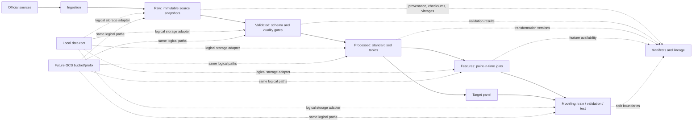

# 004. Rental Forecasting Data Architecture & Data Dictionary

**Status:** Living design and source assessment; updated for Task 006.2 on
8 November 2026. Sections 2 and 4-6 retain the proposed architecture and confirmed
forecasting decisions; Section 3 records source evidence and its limits. The
Section 7 ingestion batches are proposals for project-owner review, not approval
to implement them. No production ingestion or feature functionality is added by
this research.

## 1. Existing project decisions

The project already provides a useful foundation:

- `data/raw/`, `data/external/`, and `data/processed/` exist and are excluded
  from Git except for their `.gitkeep` markers.
- `configs/storage.toml` selects local storage and reserves a GCS bucket/prefix.
  It explicitly recommends keeping credentials out of configuration.
- `README.md` recommends an I/O abstraction, Parquet for derived data, and
  keeping production logic in `src/`.
- `src/ingestion/ons_pipr.py` implements the initial PIPR acquisition,
  immutable release registration, validation, and Parquet publication described
  in [Task 006](006-ons-pipr-ingestion.md). Preserve this implementation and its
  tests. The remaining processing, feature, model, evaluation, and pipeline
  packages remain scaffolds.
- The approved target cohort is 294 English LAs, excluding City of London and
  Isles of Scilly, with separate 1-, 2-, and 3-bedroom rent levels. Preserve the
  confirmed Option A origin and 12-calendar-month horizon in Section 4.
- Python 3.12, pandas, pyarrow, NumPy, scikit-learn, and pytest are already
  declared. This proposal does not require new packages.

The architecture below remains a proposal beyond the implemented PIPR workflow.
Source findings inform later decisions; they do not authorise additional
implementation.

## 2. Proposed architecture

### Directory layout

```text
data/
  raw/                         # Immutable source downloads/API responses
    ons_pipr/
      release=YYYY-MM-DD/
    bank_of_england/
      release=YYYY-MM-DD/
    ...
  external/                    # Externally maintained/reference inputs
  validated/                   # Source-shaped data after structural/quality gates
  processed/                   # Cleaned, typed, geography/date-standardised tables
  features/                    # Point-in-time-safe explanatory variables
  modeling/
    train/
    validation/
    test/
  manifests/                   # Small metadata, checksums, source/vintage records

docs/
  data-architecture-and-dictionary.md

src/
  ingestion/                   # Source-specific acquisition and raw registration
  processing/                  # Schema, quality checks, standardisation
  features/                    # Feature joins and point-in-time selection
  pipelines/                   # Repeatable stage orchestration
  models/
  evaluation/

configs/
  storage.toml                 # Existing local/GCS logical storage settings
```

Keep source-specific raw downloads unchanged. Store derived outputs in Parquet
for typed columns, compression, and efficient reads; retain CSV/XLSX/ODS/JSON
only when that is the original source format or is needed to reproduce the
source extraction. Do not add generated artifacts or private/licensed source
files to Git.

### Responsibilities and flow

| Layer | Responsibility | Example contents | Gate before promotion |
|---|---|---|---|
| Raw | Preserve what the publisher supplied, without edits. | Original ONS workbook/CSV, Bank of England export, retrieval metadata. | Download integrity and source/license recorded. |
| Validated | Confirm source structure and minimum quality while retaining source semantics. | Parsed source table plus validation results. | Required fields, types, uniqueness/grain, acceptable code/date values. |
| Processed | Standardise names, types, units, geography codes, and time representation; document transformations. | Monthly PIPR long table; harmonised LA reference table; annual supply table. | Transformation invariants and expected coverage pass. |
| Features | Create explanatory features with explicit observation and availability dates. | Lagged national rates, local annual supply, rolling or seasonal features. | Every joined value is available at the forecast cutoff. |
| Modeling | Assemble target and features into reproducible time-based splits. | Train/validation/test tables and split manifest. | No target leakage, split boundaries recorded, required target coverage met. |



### Names, versions, and reproducibility

- Use lowercase `snake_case` for columns and stable source identifiers. Keep
  `source_*` names in a source landing table if publisher headings are useful
  for auditability.
- Use one row per natural observation grain. A monthly rent row is keyed by
  `(geography_code, bedroom_category, observation_month, source_series_id)`;
  features also carry a source and vintage where relevant.
- Use ISO dates (`YYYY-MM-DD`) and an explicit monthly period such as
  `YYYY-MM`, rather than ambiguous month-end strings.
- Name files with dataset, grain, and vintage, e.g.
  `pipr_rent_la_bedroom_monthly__vintage=2026-10-22.parquet`. Treat the date as
  the source release/retrieval vintage, not as a substitute for observation
  date. Exact filenames should be settled after source formats are inspected.
- Record in a sidecar manifest: source URL/title, source release date (if
  supplied), retrieval timestamp, observation start/end, geography vintage,
  original filename/format, SHA-256 of raw bytes, schema version, validation
  outcome, transformation/code version, and any known licence/terms. For
  forecasts, also record `forecast_issue_date`, timezone-aware
  `forecast_cutoff_at`, selected `origin_month`, and `target_month`.
- Preserve raw vintages rather than replacing them. Version processed outputs
  by the input vintages and code revision; pin each historical forecast's
  issue/cutoff, origin/target months, training cutoff, and source vintages in
  modeling manifests. Git tracks code and small manifests, not dataset
  binaries. A data-versioning product is not necessary for the first local
  iteration; checksums and immutable release folders are a sufficient starting
  point.
- Keep paths logical and route I/O through the small storage boundary already
  anticipated by `configs/storage.toml`. Local paths can later map to
  `gs://<bucket>/<prefix>/...`; use runtime identity/secret management rather
  than placing credentials in TOML. No GCP setup is proposed now.

## 3. Data dictionary and source assessment

### Task 006.2 scope and evidence status

Inspection date: **8 November 2026**. The [original task prompt](006.2-predictor-data-availability-and-quality-exploration.md)
is archived verbatim. This assessment covers every candidate in that prompt and
three proposed supply ratios. It does not approve predictors, set quality
thresholds, assess predictive usefulness, or implement ingestion or features.

Repository review reused the [Task 005.1 audit](005.1-ons-pipr-workbook-coverage-audit.md),
[Task 006 guide](006-ons-pipr-ingestion.md), README, storage configuration,
pinned geography reference, and existing implementation/tests. **No Task 006.1
artifact or findings were found**; its conclusions cannot be assumed. Earlier
audit recommendations awaiting cohort approval are historical; the 294-LA
cohort is now approved in Task 006 and the current task.

Evidence labels apply to claims, not final dataset acceptance:

- **Verified (V):** exact variable/definition confirmed in an official source or
  inspected extract. This does not imply all years and all authorities were tested.
- **Partially verified (P):** official source identified, with unresolved field,
  coverage, access, or historical-vintage questions.
- **Unverified (U):** requested measure at the requested geography not established
  by the investigated evidence. It remains a candidate.
- **Derived (D):** proposed calculation from indicated underlying data; no derived
  predictor was constructed here.

Measured findings are recorded with URLs, UTC retrieval timestamps, SHA-256
hashes, field definitions, and denominators in [the exploration evidence](../reports/data_audits/006.2/predictor-exploration-evidence.json).
Publisher descriptions of ranges are labelled separately. No unmeasured
predictor has an asserted 294-LA completeness percentage.

### Candidate predictor assessment matrix

Source keys link each variable to the source-characteristics table below,
which supplies publication timing, revisions, accessibility, uncertainty and
open questions. Coverage means observations, not historical availability.

| Variable | Underlying source / definition and units | Geographic level | Historical coverage established here | Status / construction dependency |
|---|---|---|---|---|
| Local Authority | P0; pinned GSS code and authority name | 294 English LAs | April 2025 reference; rent observations Jan 2015-Sep 2026 | V; structural identifier, no encoding performed |
| Bedroom Category | P0; integer 1, 2, or 3 | LA by bedroom | Jan 2015-Sep 2026 | V; structural category |
| Current Rent | P0; average monthly private rent, GBP/month | LA by bedroom | Jan 2015-Sep 2026 | V; establish eligibility at each cutoff |
| 3-month Rental Growth | P0; proposed `100 * (rent[t] / rent[t-3] - 1)`, percent | LA by bedroom | Endpoints structurally possible Apr 2015-Sep 2026 in audited vintage | D; definition proposed, same-vintage eligible observations required |
| 12-month Rental Growth | P0; proposed `100 * (rent[t] / rent[t-12] - 1)`, percent | LA by bedroom | Endpoints structurally possible Jan 2016-Sep 2026 | D; no growth feature generated |
| BoE Bank Rate | B1; official policy rate, percent | UK national | Inspected change-date page spans 20 Jan 1975-5 Nov 2026; earlier history not established | V; cutoff rate/monthly-summary choice open |
| 2-year 75% LTV BTL Mortgage Rate (IUMZID4) | B2; quoted sterling mortgage rate, percent, not seasonally adjusted | UK national | Measured Jan 2012-Oct 2026, 178 consecutive months | V; historical release vintages remain P |
| Median Earnings | E1; ASHE Table 8 residence-based median employee earnings; GBP per selected annual/weekly/hourly period | LA residence | Publisher lists editions 2002-2026 provisional; row-level range unverified | P; pay period, full-/part-time and sex breakdown need selection |
| Earnings Growth | E1; proposed percentage change in consistent annual median earnings | LA residence | First usable pair unresolved; no continuous 2002-2026 LA panel assumed | D/P; pay definitions, geography and vintages must agree |
| Unemployment Rate | U1; APS survey estimate or separately labelled model-based rate, percent of economically active people aged 16+ | LA; GB modelled / UK survey products | ONS modelled indicator covers calendar 2004-2023; Nomis APS and UMB latest period Jul 2025-Jun 2026 | P; current full-series start and selected measure unresolved |
| Population Density | D1 MYE5; population per square kilometre, supplied area denominator | LA | Inspected workbook mid-2011-mid-2025 | V; 292/294 direct-code matches, no mapping applied |
| Population Growth | D1 MYE4; proposed percentage change between comparable annual mid-year populations | LA | Population mid-2011-mid-2025; annual pairs possible from 2012 on matched codes | D; revised population vintage and boundary policy required |
| Household Growth | H1/H2; proposed change in number of households, not dwellings | LA | APS estimates 2020-2022; admin-based estimates 2021-2023; projections base 2022 through 2047 | D/P; estimate/projection concepts differ, no single series approved |
| Net Internal Migration | D1 MYE3; internal inflow minus outflow, persons in year to mid-year | LA | Components inspected for year to mid-2025 only; older detailed editions identified, not exhaustively parsed | V for latest variable; P for continuous history |
| Net International Migration | D1 MYE3; international inflow minus outflow, persons in year to mid-year | LA | Same latest extract and history limitation as internal migration | V for latest variable; P for historical methods and vintages |
| Student Population Share | S1; possible Census TS068 student count / compatible population denominator, percent | LA residence / term-time residence | 21 March 2021 snapshot verified; no annual panel established | D/P; TS068 includes schoolchildren aged 5+, not specifically higher-education students |
| Average House Price / HPI | M1; UK HPI average price in GBP or index (retain series base) | LA, also regional/national | Publisher documents England/Wales transactions from Jan 1995; current inspected release describes Aug 2026 | P for exact 294-LA history; dataset/measure V |
| 12-month House-price Growth | M1; published annual change or proposed same-vintage index ratio, percent | LA | Earliest usable LA year-on-year pair unmeasured; no complete history inferred from 1995 source start | D/P; do not mix property definitions or vintages |
| Housing Completions | M2 Table 123 `New build`, dwellings completed in financial year | English LA district | Inspected sheets 2012-13 through 2024-25 | V; annual net-supply component, distinct from quarterly housebuilding return |
| Net Additional Dwellings | M2 Table 122; net stock flow, dwellings per financial year | English LA district | Inspected 2001-02 through 2024-25 | V; can be negative, includes more than new build |
| Planning Approvals | M3 PS2; granted major/minor residential application decisions, counts | Local planning authority (LPA) | Measured 2025 Q3-2026 Q2; publisher describes PS2 history from Q2 1979 | V for application counts; historical definition continuity unverified |
| CPI Inflation | C1 D7G7; all-items 12-month percentage change | UK national | Official monthly table displays Jan 1989-Sep 2026 | V; longer modelled history is distinct |
| CPIH Inflation | C1 L55O; all-items 12-month percentage change including owner-occupier housing costs, percent | UK national | Official monthly table displays Jan 1989-Sep 2026 | V; keep distinct from CPI |
| Dwelling Stock (supply denominator) | M4 Table 125 unrounded; all dwellings including vacants, count at 31 March | English LA district | Inspected 2001-2025 | V; not households or private rented stock |

P0 reuses the existing audit: 294 LAs x 3 bedrooms x 141 months = **124,362**
valid rent observations in the 21 October 2026 edition. It does not repeat the
audit or claim historical rent values were publicly available in 2015. The two
rent-growth starting dates are calendar-endpoint deductions from that panel,
not historical point-in-time completeness measurements.

### Underlying source characteristics and evidence

New external findings below were checked on 8 November 2026; explicitly labelled
earlier evidence is retained without re-audit. Release labels and dates are those
observed, not forecasts of future updates. Lags labelled estimates are calendar
arithmetic, not publisher guarantees.

| Key and official source | LA completeness / quality evidence | Publication timing and revisions | Accessibility / remaining questions |
|---|---|---|---|
| P0: [ONS PIPR, existing audit and ingestion](006-ons-pipr-ingestion.md) | Approved 294-LA panel; no target gaps in audited vintage. Historical boundary/vintage differences already documented. | Edition 21 Oct 2026; `published_at` remains unverified. Retrospective values differ between archives. | Local immutable XLSX and validated/processed Parquet implemented. No additional PIPR download. |
| B1: [BoE official Bank Rate history](https://www.bankofengland.co.uk/boeapps/database/Bank-Rate.asp) | National; LA completeness not applicable. Inspected dates cover project observation window. Full-export gap/duplicate analysis not performed. | Effective dates are not precise announcement timestamps. Retain decision publications for exact cutoffs. | HTML table/export controls; monthly transformation and earliest full history not tested here. |
| B2: [BoE IADB IUMZID4](https://www.bankofengland.co.uk/boeapps/database/index.asp?EC=IUMZID4&From=Template&G0Xtop.x=1&G0Xtop.y=1&Travel=NIxSUx) and [inspected CSV](https://www.bankofengland.co.uk/boeapps/database/_iadb-fromshowcolumns.asp?csv.x=yes&Datefrom=01/Jan/2012&Dateto=08/Nov/2026&SeriesCodes=IUMZID4&CSVF=TN&UsingCodes=Y&VPD=Y&VFD=N) | 178/178 expected months, all numeric, zero duplicate months, Jan 2012-Oct 2026. National, not LA-level. | Retrieval is not publication proof. Selection page still says 7 Oct 2026 despite CSV containing October observations; do not attach that page date to every observation. See methodology evidence below. | Parameterised CSV download demonstrated. Exact archived releases unresolved. |
| E1: [ONS ASHE Table 8](https://www.ons.gov.uk/employmentandlabourmarket/peopleinwork/earningsandworkinghours/datasets/placeofresidencebylocalauthorityashetable8) and [ASHE QMI](https://www.ons.gov.uk/employmentandlabourmarket/peopleinwork/earningsandworkinghours/methodologies/annualsurveyofhoursandearningslowpayandannualsurveyofhoursandearningspensionresultsqmi) | Residence-based employee earnings, not household income or self-employed income. 1% employee-job sample; uncertainty/CVs and suppressed cells matter. LA completeness unmeasured. | April reference information, annual publication; 2026 provisional / 2025 revised released 22 Oct 2026. About six months from April is an estimated lag. Method breaks in 2004, 2006, 2011 require review. | ZIP/spreadsheets; 2026 ZIP returned HTTP 403. Median-field/suppression parsing awaits accessible extract; metadata availability does not establish automated access. |
| U1: [Nomis APS](https://www.nomisweb.co.uk/datasets/apsnew), [UMB modelled unemployment](https://www.nomisweb.co.uk/datasets/umb), [ONS modelled indicator](https://www.ons.gov.uk/explore-local-statistics/indicators/modelled-unemployment) | Survey APS and modelled unemployment are distinct. Small LA survey samples can be unreliable; model borrows claimant-count information and has confidence intervals. No 294-code extract measured. | Rolling 12-month estimates updated quarterly. Latest Nomis period ends Jun 2026; APS metadata `LastUpdated` is 20 Oct 2026: observed 112-day gap from 30 Jun, not guaranteed lag. Reweighting/corrections affect history. | Query/export and JSON metadata demonstrated for APS `NM_17_5`; this endpoint is APS, not UMB. UMB fields, all-area coverage and historic calendar unresolved; claimant count must not replace unemployment silently. |
| D1: [ONS England/Wales population estimates](https://www.ons.gov.uk/peoplepopulationandcommunity/populationandmigration/populationestimates/datasets/estimatesofthepopulationforenglandandwales) and [mid-2025 release](https://www.ons.gov.uk/peoplepopulationandcommunity/populationandmigration/populationestimates/bulletins/populationestimatesforenglandandwales/mid2025) | MYE4 population, MYE5 area/density, MYE3 migration inspected. 292 direct project-code matches, zero duplicate matched codes; Barnsley/Sheffield use other codes. Population/density numeric on 292 rows for 2011-2025; latest migration fields numeric on 292. Small-area uncertainty applies. | Released 29 Jul 2026 for mid-2025: about 13 months (estimate). Revises mid-2022-2024 with improved migration information; latest vintage is not historical knowledge. | XLSX retrieved; area in square kilometres supplied, avoiding a separate denominator source for this definition. Detailed time-series editions and mid-2001-2011 archive identified; older component continuity unmeasured. |
| H1: [ONS APS household estimates, request 1886](https://www.ons.gov.uk/peoplepopulationandcommunity/birthsdeathsandmarriages/families/adhocs/1886estimatednumberofhouseholdsingreatbritaininitl1itl3englishandwelshlocalauthoritiesandscottishcouncilareas2020to2022) and [admin-based households 2021-2023](https://www.ons.gov.uk/peoplepopulationandcommunity/populationandmigration/populationestimates/bulletins/adminbasedhouseholdestimatesforlocalauthoritiesinenglandandwales/latest) | Exact LA products identified; file completeness unmeasured. APS sampling uncertainty differs from admin-based address/household-definition uncertainty. Admin-based estimates lack uncertainty measures and revised their methods. | APS 2020-2022 released 12 Mar 2024. Admin-based 2021-2023 released 8 Sep 2026; publisher says these development estimates support comparison and should not be used for decision-making. | Named XLSX links not parsed. Investigate comparable earlier APS extracts/vintages. Retain admin-based candidate for investigation with publisher restriction explicit; no rejection or modelling approval made. |
| H2: [ONS household projections](https://www.ons.gov.uk/peoplepopulationandcommunity/populationandmigration/populationprojections/datasets/householdprojectionsforengland) and [2022-based context](https://www.ons.gov.uk/peoplepopulationandcommunity/populationandmigration/populationprojections/bulletins/householdprojectionsforengland/2022based) | Future LA households under demographic assumptions; not observed annual household growth. Principal geography Apr 2022; migration-category variant also on Apr 2023 geography. No measured 294-LA compatibility. | Released 28 Oct 2025, base 2022, through 2047. New vintages supersede assumptions; future reference years usable only after vintage release. | XLSX/ZIP, older 2018-/2016-based editions identified. Observed versus projection-derived growth, scenario and historical-vintage use require approval. |
| S1: [ONS TS068 original release](https://www.ons.gov.uk/datasets/TS068/editions/2021/versions/1), [Nomis definition](https://www.nomisweb.co.uk/datasets/c2021ts068), [bulk files](https://www.nomisweb.co.uk/census/2021/bulk) | Usual residents aged 5+ in full-time education, including schoolchildren; away-from-home students use term-time address. Disclosure perturbation can affect reconciliation. Census/current boundaries differ; 294-LA recombination unmeasured. | Census day 21 Mar 2021; first release 10 Jan 2023, newer versions available. Not known in 2015. Comparison with 2011 has age-definition change. | Bulk CSV ZIP/query identified. Age, numerator/denominator and whether intended measure is higher-education students need approval; HESA provider enrolment is a different concept, not an approved substitute. |
| M1: [HMLR UK HPI methods](https://www.gov.uk/government/publications/about-the-uk-house-price-index/about-the-uk-house-price-index), [Aug 2026 release](https://www.gov.uk/government/statistics/uk-house-price-index-for-august-2026/uk-house-price-index-summary-august-2026), [CSV downloads](https://www.gov.uk/government/statistical-data-sets/uk-house-price-index-data-downloads-august-2026--2) | LA mix-adjusted completed-sale prices; fewer local transactions mean larger revision effects. Jan 1995 England/Wales start does not prove fixed-geography LA completeness. | Aug 2026 published 21 Oct 2026: about two months (estimate). Methods page describes 12-month standard revisions and exceptional older revisions; verify edition policy. UK HPI introduced Jun 2016; earlier reference years retrospective for this product. | Monthly CSV vintages/revision tables identified; full file deliberately not downloaded. All-property measure/base, code continuity, 294-LA completeness and exact vintage retrieval await verification. |
| M2: [MHCLG Tables 122/123](https://www.gov.uk/government/statistical-data-sets/live-tables-on-net-supply-of-housing), [2024-25 release](https://www.gov.uk/government/statistics/housing-supply-net-additional-dwellings-england-2024-to-2025/housing-supply-net-additional-dwellings-england-2024-to-2025) | ODS inspected; latest 292/294 direct-code numeric rows. Newer-authority codes have historical gaps. Publisher imputation, Census calibration and component changes occur. Negative net additions are not automatically invalid. | Apr-Mar year; 2024-25 published 20 Nov 2025, about eight months after year-end (estimate). Provisional/revised flags; Census reconciliation changes history. | Small ODS downloads succeeded. Components/layout vary by sheet; retain notes and imputation styling. Annual new build differs from quarterly housebuilding return; no boundary aggregation performed. |
| M3: [MHCLG planning live tables](https://www.gov.uk/government/statistical-data-sets/live-tables-on-planning-application-statistics), [district dictionary](https://assets.publishing.service.gov.uk/media/68516a97dc640d9b20f3e92a/District_Matters_-_Data_dictionary.pdf), [release](https://www.gov.uk/government/statistics/planning-applications-in-england-april-to-june-2026) | PS2 sample: all 294 codes once per quarter; both residential granted fields numeric. LPA responsibilities need not cover exactly a LAD's land area; direct code match is insufficient proof. Applications are not units. | Q2 2026 published 24 Sep 2026: 86 days after Jun-end (observed); corrected 29 Oct 2026. Publisher describes PS1 from Q2 1996 and PS2 from Q2 1979; historical definitions unmeasured. | Four-quarter CSV fetched; cp1252, two preamble rows, 334 columns. Full 59 MB history not downloaded. Distinguish major/minor residential decisions, householder/commercial decisions and permission units. |
| M4: [MHCLG dwelling stock, Table 125](https://www.gov.uk/government/statistical-data-sets/live-tables-on-dwelling-stock-including-vacants) | Rounded/unrounded sheets inspected; use unrounded for ratios without claiming census accuracy. Latest 292/294 direct-code matches; historic current-code gaps. Census baseline plus net additions is not an independent annual census. | 31 Mar 2025 stock published 21 May 2026: about 14 months (estimate). Workbook has provisional/revised flags and future Census rebasing. | ODS retrieved. Table 100 tenure and Table 116 council-owned stock differ from all-dwelling denominator. See standardisation assessment. |
| C1: [ONS CPI D7G7](https://www.ons.gov.uk/economy/inflationandpriceindices/timeseries/d7g7/mm23), [CPIH L55O](https://www.ons.gov.uk/economy/inflationandpriceindices/timeseries/l55o/mm23), [MM23 versions](https://www.ons.gov.uk/economy/inflationandpriceindices/datasets/consumerpriceindices/current) | National percent series; LA completeness not applicable. Monthly historical/latest rows inspected on official tables; full duplicate/gap analysis not performed. | Sep 2026 published 21 Oct 2026: 21 days after Sep-end (observed). Previous release versions/correction notices available; historical numbers were not necessarily published in their reference month. | Series CSV/XLS available; avoid full 23 MB MM23 for two series. Earlier modelled/backfilled history has different availability. |

**BTL history and release evidence.** The [BoE September 2016 paper](https://www.bankofengland.co.uk/-/media/boe/files/statistics/bankstats-articles/2016/forthcoming-improvements-to-interest-rate-statistics---bankstats-article.pdf?hash=09A713F2C36E4E882504CBD3EDB727F344F44513&la=en)
identifies IUMZID4 as a new series backdated to January 2012: earlier observation
history is not proof of contemporaneous publication. The [March 2019 changes](https://www.bankofengland.co.uk/-/media/boe/files/statistics/bankstats-articles/2019/introduction-of-new-quoted-rates-data.pdf)
expanded sampling, changed weighting/product selection, changed end-month
measurement to monthly average, and moved publication to fifth working day with
next-month reweighting. The [general FAQ](https://www.bankofengland.co.uk/Statistics/faqs)
still describes working days 5 and 21. These general/specific cadence descriptions
conflict: verify actual relevant release calendars in Task 007 rather than assuming
one lag throughout history. Do not silently splice measurement regimes or treat
the latest CSV as a historical-vintage archive.

**Existing household-income evidence retained.** The earlier investigation
identified [regional GDHI](https://www.ons.gov.uk/economy/regionalaccounts/grossdisposablehouseholdincome/datasets/regionalgrossdisposablehouseholdincomegdhi)
at ITL1/2/3 in its inspected 1997-2024 edition, not a verified LA income panel.
Median employee earnings is a different measure; neither is silently substituted
for household income. That prior GDHI range was not re-audited here.

### Quantitative exploration and geography limitations

These are file measurements, **not pass/fail tests or acceptance scores**. Every
LA denominator below is the unchanged **294** `target_eligible=true` codes in
the pinned April 2025 reference. Matching uses exact codes without name matching,
recoding, filling or aggregation. Numeric means finite after removing display
thousands separators; `[x]` remains unavailable. No duplicate matched authority
code was found in inspected annual sheets, nor authority-quarter in the PS2 sample.

| Inspected extract / fields | Measured observations | Measurement limits |
|---|---|---|
| B2 IUMZID4 | 178 monthly rows Jan 2012-Oct 2026; 0 missing calendar months, 0 duplicate months, 0 nonnumeric values | One vintage, not a revision comparison |
| D1 MYE4 population / MYE5 density | 292/294 exact codes; 292 numeric values every year 2011-2025; MYE5 supplies area | Two code mismatches; no historical migration/uncertainty validation |
| D1 MYE3 migration | 292/294 codes, numeric internal/international inflow, outflow, net for year to mid-2025 | One component year, not a full migration panel |
| M2 Table 122 net additions | Numeric matches: 272/294 in 2001-02 to 2008-09; 281 in 2009-10 to 2018-19; 285 in 2019-20; 286 in 2020-21; 288 in 2021-22/2022-23; 292 in 2023-24/2024-25 | Source includes predecessor authorities; current-code gaps do not prove absent underlying activity |
| M2 Table 123 new build | 277/294 in 2012-13; 281 in 2013-14 to 2018-19; 285 in 2019-20; 286 in 2020-21; 288 in 2021-22/2022-23; 292 in 2023-24/2024-25 | Layout/code changes; source imputation flags not quantified |
| M4 Table 125 unrounded stock | 272/294 in 2001-2009; 281 in 2010-2019; 285 in 2020; 286 in 2021; 288 in 2022/2023; 292 in 2024/2025 | Stock dates, not financial-year flows; Census reconciliation affects comparison |
| M3 PS2 sample | 1,240 source rows; 294/294 codes per quarter 2025 Q3-2026 Q2; 1,176 cohort authority-quarter rows, both residential granted fields numeric | Other 64 source rows outside cohort, retained in source; no claim about earlier years |
| M3 Glenigan Table_3 | 18 quarterly endpoints 2022 Q1-2026 Q2, annual rolling units/permissions for England; no LA dimension | Does not establish open LA units-granted series |

Recurring exact-code mismatches are **Barnsley** (source `E08000016`, project
`E08000038`) and **Sheffield** (source `E08000019`, project `E08000039`). The
source rows exist: 292 direct-code matches must not be described as two absent
geographic observations. Gateshead also uses an older code in Table 123's 2012-13
sheet. Names alone do not establish boundary equivalence. Retain original codes
and obtain approval for effective-dated mappings; this task changes neither the
cohort nor geography reference.

A source numeric value can already contain publisher imputation or adjustment.
Table 123 identifies imputation partly by colour; its Notes year labels lag its
latest sheet. Table 122 notes historical imputations. Text-only parsing would
lose this information. Later ingestion must preserve styles/notes and investigate
inconsistencies rather than assuming all numeric observations are unadjusted.

### Dwelling-stock denominators and supply standardisation

The investigated denominator is **Table 125 all-dwelling stock**, including
vacants, at 31 March. It is neither households, private rental stock, nor
council-owned dwellings. These are construction proposals, not implemented
features or final operating definitions.

| Proposed standardised predictor | Numerator / compatible denominator | Evidence / outstanding decision |
|---|---|---|
| New-build completions per 1,000 existing dwellings | Table 123 `New build` in financial year Y/Y+1 / Table 125 unrounded all-dwelling stock at chosen 31 March, multiplied by 1,000 | Same publisher/dwelling concept support investigation. Consider start-year 31 March Y stock, subject to approval; do not silently pick end-year or mean stock. |
| Net additional dwellings as a percentage of existing dwelling stock | Table 122 net additions in Y/Y+1 / same explicitly dated stock, multiplied by 100 | Includes conversions, change of use, other changes and demolitions. Census calibration/revisions mean simple stock difference need not equal reported flow. Negative net changes can be valid. |
| Approved residential units per 1,000 existing dwellings | Actual units granted by compatible LA and period / matched all-dwelling stock, multiplied by 1,000 | **U for an openly accessible LA numerator in inspected sources.** PS2 counts decisions, not units. Glenigan's England rolling-annual table cannot supply local units or be differenced into quarterly units. Unresolved, not excluded. |

The [planning technical notes](https://www.gov.uk/government/statistics/planning-applications-in-england-april-to-june-2026/planning-applications-in-england-april-to-june-2026-technical-notes)
define units granted at detailed permission or reserved-matters approval, with
rules for phases and repeated permissions. Establish whether a usable local
units extract exists, its rights and geography before proposing implementation.
A count of major residential applications is not a count of homes approved.

Numerator and denominator need compatible boundaries; predecessor districts,
counties or National Park LPAs cannot silently stand for LAs. Financial-year
flows, 31 March stock and calendar-quarter approvals have different periods.
Even a start-year denominator can be published after its numerator: 31 March
2025 stock was released in May 2026. A ratio's earliest defensible availability
is no earlier than **both** input vintages' releases, not stock date or year-end.
No fill/lag rule or boundary conversion is approved here.

### Access, licences and reproducible evidence

Eight successful targeted extracts total about 2.9 MB. No full ASHE history,
full planning history, large population time-series or full HPI file was downloaded.
Local originals/manifests are in `data/external/006.2-research/`, excluded from
Git by existing rules and separate from production raw/validated releases.
The [evidence JSON](../reports/data_audits/006.2/predictor-exploration-evidence.json)
retains URLs, hashes, UTC times, measured counts, field definitions and query
parameters without committing source datasets.

Reproduction uses standard-library ZIP/XML/CSV inspection: select `LT_122`,
`LT_125_unrounded`, and year-named Table 123 sheets; locate `New build` by
header rather than assuming component offsets. Resolve XLSX workbook
relationships/shared strings for `MYE3`, `MYE4`, `MYE5`. Read PS2 as cp1252,
third row as header, key `LPACD, Quarter`. Match exact cohort codes and count
numeric observations, source markers and duplicate keys separately. Compare
IUMZID4 monthly dates against the inclusive monthly calendar. Evidence JSON
records rules/per-period results; this is exploratory inspection, not a
production parser or full validation suite.

ONS pages, MHCLG publications and [BoE Database terms](https://www.bankofengland.co.uk/legal)
identify Open Government Licence reuse, subject to attribution/exceptions.
Record dataset-specific notices with future snapshots. Do not infer that
Glenigan microdata are openly redistributable because government aggregates
are published, or all Nomis-hosted products have identical terms. No restricted
account, paid dataset or external contact was used.

### Point-in-time interpretation

Separate observation period, actual publication/availability time, release
vintage and retrieval time. Retrieval on 8 November 2026 proves access then,
not before. Release dates alone do not establish intraday availability; do not
invent midnight `published_at`. Backfilled launches (IUMZID4/UK HPI), Census
releases, migration/population revisions and corrected planning data illustrate
why current completeness is not historical availability. Sections 4 and 6
retain the approved forecast convention and PIT requirements.

No candidate was excluded on quality grounds; no arbitrary score, completeness
threshold, operating lag, transformation, imputation, correlation analysis or
model experiment was introduced.

## 4. Target variable specification

### Definition

**Confirmed decision (Option A):** the 12-calendar-month horizon is anchored
to the latest eligible published rent observation month, not the forecast
issue month.

For each forecast, define:

```text
forecast_issue_date       = calendar date the forecast is generated
forecast_cutoff_at        = precise timezone-aware timestamp of its information cutoff
origin_month              = latest eligible published monthly rent observation month
target_month              = origin_month + 12 calendar months
forecast_horizon_months   = 12
```

The confirmed policy measures the horizon from the latest eligible published
rent observation month, not from the calendar month in which the forecast is
issued. For example, an illustrative forecast issued on 2026-10-22 could use
origin month 2026-09 and target month 2027-09, if the September rent observation
is confirmed published and eligible by that forecast's cutoff. The example is
not evidence of a specific ONS publication date or cutoff time.

For Local Authority `LA`, bedroom category `b ∈ {1, 2, 3}`, and origin month `t`:

```text
y(LA, b, t) = Rent(LA, b, t + 12 calendar months)
```

The outcome is the **future rent level in GBP per month**, not the 12-month
percentage growth rate. A growth-rate target can be derived later as a separate
experiment; it is not interchangeable with this target.

Recommended target-table grain:

```text
(forecast_issue_date, forecast_cutoff_at, geography_code, geography_vintage,
 bedroom_category, origin_month, target_month, target_rent_gbp,
 target_source_series_id, target_vintage)
```

- `forecast_cutoff_at` must include an explicit timezone/offset. The actual
  forecast issue date and cutoff timestamp are recorded per run; the operational
  timezone and scheduled cutoff convention remain to be chosen.
- Select the latest rent observation month that was genuinely published and
  available by `forecast_cutoff_at`; a month is not eligible merely because it
  has ended. `target_month` is exactly 12 calendar months after this
  `origin_month`.
- Store LA identifiers as official GSS geography codes, not names. Keep the
  source's own geography code and a dated crosswalk to canonical codes.
- Represent bedroom categories with controlled values `1`, `2`, and `3`.
  Do not include “all properties”, studios, or other categories in these
  series.
- Represent months as calendar-month periods. `target_month` is exactly 12
  calendar months after `origin_month`; it is not a 365-day duration.
- The forecast issue date, cutoff timestamp, and origin month are separate
  fields. `origin_month` identifies the latest eligible published rent month
  at the cutoff; it can precede the issue month. A particular observation must
  not be used to define the origin unless it was published by that cutoff.
- PIPR is a statistical estimate of average market rents, not a census of
  tenancy contracts. It may have sampling/administrative coverage limitations,
  small-sample effects, delayed publication, provisional values, and revisions.
  The released series definition and uncertainty notes should be retained.
- Missing or discontinued LA/bedroom observations stay missing and are
  explicitly flagged. Do not interpolate target labels or combine different
  source definitions to make a continuous-looking target.
- Latest eligible rent months can differ by LA or bedroom if source coverage,
  publication, or series continuity differs. For cross-area comparisons,
  recommend one common `origin_month` per forecast run: the latest rent month
  published by `forecast_cutoff_at` that meets a predeclared completeness rule
  across the fixed comparison cohort of LA-by-bedroom series. Do not let each
  row silently pick a different origin, since that would compare different
  target months.
  Confirm the cohort and completeness threshold after auditing official PIPR
  tables. If a series is missing or delayed at the common origin, keep its
  target unavailable, flag/exclude that row for that forecast, and report
  coverage; do not impute target values. A per-series latest-origin policy
  could be retained for separate operational forecasts, but must be labelled
  and not mixed into common-origin evaluation.

### Boundary and series continuity policy

Maintain a versioned geography dimension with code, name, nation, valid-from /
valid-to dates, and source boundary version. For a boundary change:

1. Prefer a publisher-provided consistent historical series or an official
   code/area correspondence.
2. Preserve the original geography series and document any mapped target
   geography.
3. Do not split or aggregate an average rent by averaging component LA averages
   without an appropriate rent/household/transaction weight.
4. If a defensible consistent target cannot be constructed, terminate the old
   series and start the new one, or exclude the affected geography/time span
   from that evaluation. Record the decision in the target manifest.

Historical backtests must reconstruct for every forecast row its historical
`forecast_issue_date`, timezone-aware `forecast_cutoff_at`, latest eligible
published rent `origin_month`, corresponding 12-month-ahead `target_month`,
and the feature values/vintages available at that cutoff. A label is eligible
for model training only if its target observation was published by the
historical model-training cutoff; do not use a label merely because its target
month has elapsed. For evaluation, score against a selected reference target
vintage, separate from the vintage available at the forecast cutoff.

## 5. Data validation strategy

Run checks at each layer and write structured outcomes to the run manifest.
Validation failures should identify dataset, partition, rule, and offending
sample rows without copying large or sensitive data into logs.

| Check | Hard failure (stop promotion) | Warning / review |
|---|---|---|
| Required schema and types | Required key/value fields absent; dates or values cannot be parsed; incompatible breaking schema change. | New optional source columns, reordered columns, or documented additive change. |
| Observation grain / duplicates | Duplicate natural keys after source-defined deduplication; conflicting values for the same source key. | Exact duplicate source rows that can be removed by a documented rule. |
| Missingness | Missing key, target value, source code, observation date, or availability/vintage field needed for PIT use. | Missing non-key feature values within declared thresholds; retain missingness flags and report by LA/time. |
| Geography | Invalid/unrecognised code, wrong nation, or many-to-one join not explained by an effective-dated crosswalk. | New/retired codes or name-only changes when the official crosswalk explains them. |
| Time | Invalid dates, impossible target offset, duplicate month, or unexpected gaps in a source declared complete/monthly. | Gaps caused by genuine source discontinuation, source publication lag, or explicitly irregular/annual/quarterly series. |
| Categories | Bedroom not in `{1, 2, 3}` in target; unexpected source category with no mapping. | New source category not used in current model, pending mapping review. |
| Values | Non-positive target rent; non-finite numeric values; impossible rate/percentage bounds under the documented definition. | Extreme but plausible values, abrupt month-to-month changes, or estimates with low reliability. |
| Outliers | Fail only when a value violates a known physical/domain constraint or parse/schema rule. | Statistical thresholds, robust z-scores, large change flags; never auto-delete a valid rent as an outlier. |
| Source freshness | Required scheduled source is absent or older than the configured maximum for the run's as-of date; partial download/checksum mismatch. | Source has not yet published the expected period but is within its documented release window. |
| Completeness | Required source partition or required series coverage falls below the predeclared minimum for target geography/months. | Coverage changes consistent with known boundary or series changes, after explicit approval. |
| Schema drift | Unknown key, unit, geography, or series definition; changed meaning/unit without approved mapping. | Additive metadata or non-key field changes that do not affect meaning. |
| Point-in-time availability | Any feature record has `available_at` after forecast cutoff, or a value's vintage cannot be established. | Conservative lag is being used because release timestamps are unavailable; record and review that limitation. |

Thresholds for feature missingness, series coverage, outlier flags, and source
freshness should be configured per source only after observing source release
cadence and quality. The target should have strict key/value checks and no
imputation. Warnings are not a substitute for a documented decision when
coverage or meaning changes.

## 6. Point-in-time data and leakage prevention

### Required time fields

Every observation used as a feature should preserve:

- `observation_period`: period the statistic describes;
- `published_at` or `available_at`: earliest date/time the value was public;
- `retrieved_at`: when this pipeline obtained it;
- `source_vintage`: release or edition identifier;
- optionally, `valid_from` / `valid_to` for geography or reference data.

Observation time and information-availability time are different. A December
labour estimate released in January is not available to a forecast issued in
December. A rent, house-price, or labour series later revised is not
automatically the value a historical model could have observed.

### As-of feature selection

For a forecast cutoff timestamp `c`, only select records with
`available_at <= c`. This applies to the rent observation used to establish
`origin_month` as well as every explanatory feature. Among records for the
same natural key, select the newest source vintage available by `c`, not the
latest vintage currently on disk. A feature's observation period may be
earlier than, equal to, or later than the rent origin month if its information
was genuinely available by `c`; never infer availability from observation
period alone. Store each feature's observation period, availability timestamp,
source vintage, and retrieval metadata so the as-of join can be audited.

If a publisher does not provide release timestamps or archived vintages:

1. Define and document a conservative availability lag based on the source's
   actual publication calendar.
2. Do not claim exact historical point-in-time reconstruction.
3. Prefer archived snapshots collected prospectively. Mark backtests as
   **exact point-in-time reconstruction** only when historical publication
   timestamps and source vintages support reconstruction of what was available
   at each cutoff. Otherwise label them **approximate retrospective
   backtests**, identify the lag/vintage assumptions, and disclose unavailable
   historical release snapshots.

### Frequency, lags, and carry-forward

- Monthly series may be joined only when the observation has been released by
  the cutoff, whether its observation period is before or after `origin_month`.
  A one-month observation lag is not inherently enough; use the actual
  publication date or a conservative source-specific lag.
- For quarterly and annual data, retain the quarter/year and publication date.
  Use the latest released value and carry it forward only until a declared
  maximum age; add `feature_age_months` and stale/missing flags.
- Forward-filling is a representation of “latest known value”, not new
  measurement. It must not fill backward, cross a source-definition break, or
  persist indefinitely. Do not forward-fill the target.
- For irregular policy rates, construct month-level summaries from only
  changes effective/known by the cutoff. State whether the feature is
  month-start, cutoff rate, or monthly average; a full-month average is
  unavailable before month-end.
- Never use a future-available observation, revised future vintage, centered
  rolling window, or a feature engineered using information not published by
  `forecast_cutoff_at`. The origin month is a target-horizon anchor, not the
  feature availability cutoff.

Modeling splits should be chronological, with each forecast row materialized
as-of its own historical cutoff and with the common origin/target-month policy
applied consistently. Fit scalers, imputers, feature selection, and any other
learned transformations on training data only. Recreate the same
feature-availability rules in backtests as in production.

## 7. Proposed production ingestion batches

**For project-owner review only.** These batches replace the earlier generic
one-feature-at-a-time proposal with related sources grouped around access and
validation needs. Task 007 retains Bank Rate and IUMZID4. Numbers below are
proposed reservations, not authorisation or newly created task prompts.
Production sources remain distinct datasets with independent validation and
publication checkpoints even when implemented within one batch.

| Proposed task | Datasets and rationale | Implementation considerations / dependencies | Suggested validation checkpoint |
|---|---|---|---|
| **007. Bank of England financing data** | Bank Rate and IUMZID4; common publisher, IADB exports and national geography | Preserve change-date versus monthly grains. Confirm quoted-rate measurement breaks, actual publication calendar, revised weights and archives. Choose cutoff/monthly policy-rate semantics separately; no averaging implemented here. | Independently reconcile both exports with official rows; report date gaps and metadata, preserve release bytes, and demonstrate vintage-aware rerun/failure behavior before next batch. |
| **008. ONS inflation and UK HPI** | CPI/CPIH series plus HMLR/ONS UK HPI; monthly price releases and common timing controls | Keep national inflation and LA house prices separate; independent adapters/contracts despite related release cycle. Select all-property HPI, base, geography, revisions and vintage sources; do not infer missingness from national coverage. | Reconcile each series with its official release; report all-294 HPI code/month coverage and revisions; verify that later publications cannot enter earlier cutoff examples. Review each dataset independently. |
| **009. ONS local earnings and unemployment** | ASHE Table 8 and Nomis APS/UMB; related labour-market definitions and survey-quality metadata | Resolve ASHE access, pay/sex/working-pattern measure, and survey versus modelled unemployment before implementation. Retain source uncertainty/suppression, distinct annual versus rolling-year periods and revisions. | Inspect selected fields with source examples, quantify historical/cohort coverage and uncertainty markers, preserve missing/suppressed records, and review each source contract. No arbitrary data rejection threshold. |
| **010. ONS population, area and migration** | MYE3/MYE4/MYE5 and necessary older component editions; same workbook family and code-vintage issues | Investigate Barnsley/Sheffield codes and older authority changes; approve mapping before use. Retain area units, year-ending migration definitions, revised population components and source vintages. Density/growth construction remains a later feature task. | Reproduce the measured 292 exact-code result, explain additional matches only through approved evidence, and report historical component coverage and vintage revisions. |
| **011. MHCLG housing supply and dwelling stock** | Tables 122, 123 and 125; annual dwelling accounting with numerator/denominator dependencies | Retain sheet-specific components, source imputation/style/footnotes, Census adjustments and stock dates. Agree common geography and proposed denominator timing before any ratio implementation. | Reconcile selected source rows/components and report per-year code coverage separately for all three files; demonstrate preservation of previous validated releases on failure. Review compatibility without constructing features. |
| **012. MHCLG planning decisions and permission-unit investigation** | PS1/PS2 residential approvals; same publisher and quarter-based returns. Treat local units as a separate conditional source investigation within the batch. | Preserve decision counts versus dwelling units, LPA/LAD differences, category changes, cp1252/preamble parsing and corrections. A local units source and rights must be established before its ingestion is approved. Do not replace units with application counts. | Reproduce 294 codes per quarter in the inspected sample, extend reported history checks, reconcile categories, and present a separate evidence/approval checkpoint for any LA units source. |
| **013. ONS household and student context** | Selected household estimate/projection source and Census student table; shared unresolved residence, population-universe and static/vintage interpretation | Define household growth and student numerator/denominator first. Investigate earlier APS extracts, admin-based development restrictions and comparable Census geography. Keep projection scenarios separate from estimates; no HESA substitution. | Review source/definition decisions before coding; then quantify selected source coverage and show dated vintages, boundary treatment and uncertainty. If definition remains unresolved, record that component without inventing a substitute. |

The batches can share research conventions, but a finding in one does not
approve another. The sequence puts verified, small national financing exports
first, follows with monthly price data, then survey and demographic families,
then compatible annual dwelling flows/stock and planning, with less settled
household/student definitions reserved for a review checkpoint. Definition and
geography research can precede these implementation tasks without changing the
approved objective. No source's place in this sequence is a usefulness ranking
or quality-based exclusion.

After ingestion review, propose separate tasks for PIT feature construction,
preprocessing and chronological model evaluation. Preserve raw vintages,
configuration/code lineage, logical storage paths and existing validated outputs.
No cloud deployment, dependency installation or modelling is authorised here.

## 8. Findings and decisions for project-owner review

### Established findings

- Existing PIPR evidence supports structural controls and the underlying rent
  observations for proposed growth calculations; no repeat coverage audit was needed.
- The inspected IUMZID4 export is continuous from January 2012 to October 2026,
  but the series was introduced retrospectively in 2016 and changed methods in
  2019. A complete current series is not an exact historical backtest input.
- Population, density and dwelling-supply/stock extracts show a recurring code
  mismatch for Barnsley and Sheffield. Their source rows exist; historical
  authority changes cause further direct-code gaps. No codes were changed.
- Planning application decisions have measured recent coverage for all 294
  project codes. The inspected units-granted workbook is England-level,
  leaving local approved units unresolved.
- All-dwelling stock is a verified candidate denominator; financial-year flows,
  stock dates, boundary compatibility and actual releases must all agree.

### Decisions and research still required

1. **Geography policy:** approve effective-dated code/boundary mappings,
   including Barnsley/Sheffield and predecessor authorities. Distinguish pure
   code changes from boundary changes; do not aggregate average rents or
   reweight index series without a justified, approved method.
2. **Labour/income definitions:** choose residence-based annual/weekly/hourly
   median earnings, population breakdown, and survey or modelled unemployment.
   ASHE ZIP access returned 403, so field-level completeness remains unresolved.
   The prior regional GDHI finding is retained, not relabelled LA income.
3. **Household/student definitions:** choose observed estimate growth or a
   clearly identified released projection; determine appropriate student ages,
   denominator and residence concept. Schoolchildren/full-time students are
   not synonymous with university students. No annual student history was verified.
4. **Supply standardisation:** approve start-year/end-year/other denominator
   timing and treatment of revised/Census-adjusted inputs. Find an accessible,
   licensed LA dwelling-units-granted measure if available; retain the candidate
   as unresolved if not. Application counts cannot silently substitute for it.
5. **Publication and vintage evidence:** verify actual historical release
   dates/times and archived values for every selected source. Reconcile BoE
   cadence descriptions, stale series-page date versus newer CSV content, and
   release-specific HPI revision rules. Existing current-vintage data do not
   support a claim of exact historical PIT reconstruction.
6. **Unmeasured coverage:** quantify ASHE, selected unemployment, household,
   Census and HPI LA histories once definitions/access are resolved. Inspect
   older migration components and metadata before asserting a continuous panel.
   Small samples and published ranges must not become invented completeness statistics.
7. **Operating decisions retained:** confirm forecast timezone/schedule,
   common-origin missing-series policy and canonical target vintage in their
   later tasks. This assessment does not impose thresholds or change Option A.
8. **Missing prior context:** supply or locate Task 006.1 findings if they
   exist outside this checkout; none were available to incorporate here.
9. **Roadmap approval:** review proposed Tasks 007-013 and any split/merge before
   implementation. No approval is inferred from successful source access.

### Verification record and scope limits

The prompt archive is byte-identical to the attachment. The evidence JSON
records eight successful extract downloads and the ASHE 403 failure, with
checksums and UTC retrieval times. Reported counts use the pinned 294-code
reference, source-specific periods and explicit numeric/duplicate definitions.
The quantitative checks concern inspected source files only; they are not
comprehensive production data validation. Documentation checks verify candidate
inventory coverage, table structure, local references, evidence/source hashes,
and preservation of Sections 4-6. Application tests are not a substitute for
research evidence; no production functionality was added.

Only this living dictionary, the original Task 006.2 prompt archive and a small
machine-readable evidence report are intended repository changes. Research
samples remain under the existing ignored data folder. No source datasets were
added to Git. Application code, configuration, dependencies, feature matrix,
models, cloud resources, commits and pushes were not added or changed. Candidate limitations
are documented without feature exclusion or final acceptance decisions.
